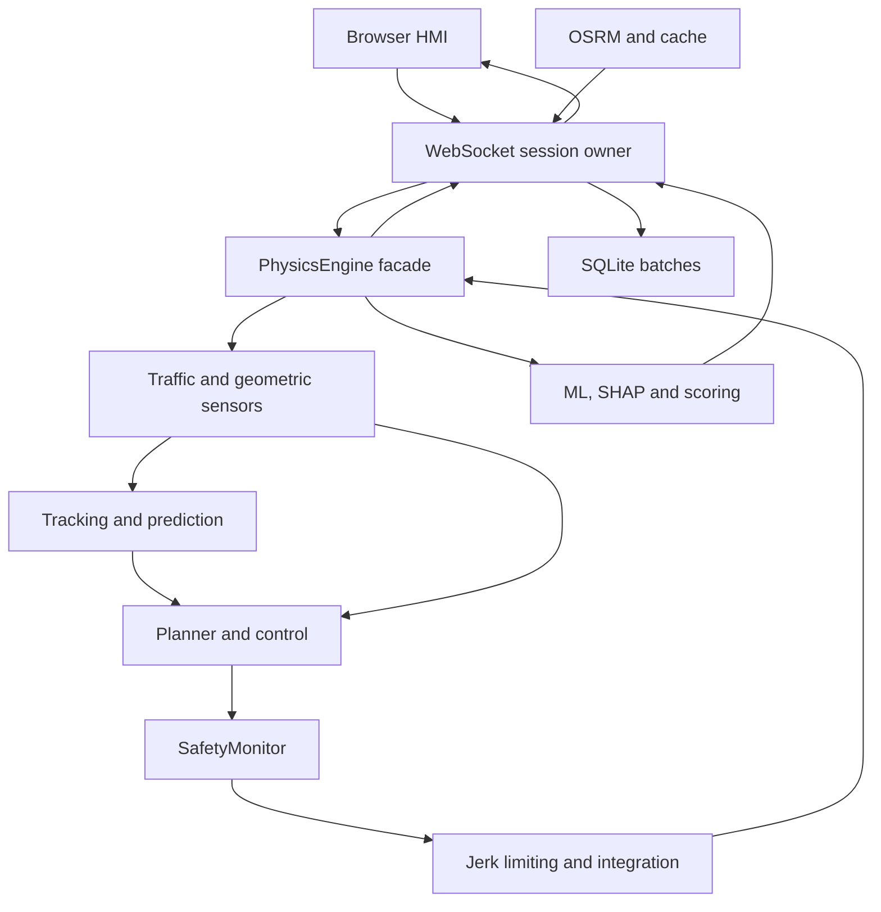
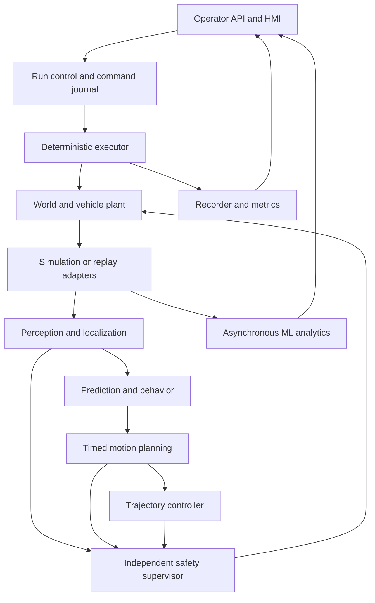
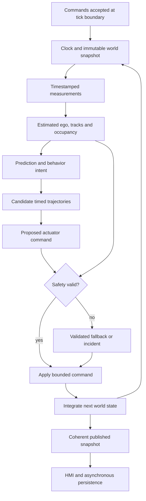

# DDS — Engineering Audit and Production Transformation Blueprint

**Audit date:** 7 October 2026  
**Repository:** https://github.com/pavann19/DDS  
**Audited commit:** `37421df8a47098792cb784e0b604ba87aa461235`  
**Scope:** software-defined driving decisions and autonomous-driving simulation, with no physical automotive hardware.  
**Deliverable:** an engineering analysis and implementation blueprint. The proposed modernization has not been implemented.

## Scope, evidence and reading guide

This report is grounded in the source, tests, data, configuration, artifacts and documentation at the pinned commit, together with checks executed during this audit. Repository-relative paths and function/class names identify evidence; Appendix 2 provides immutable source links. The runtime was inspected rather than inferred from README diagrams. Historical commits, private evidence directories and production deployments were outside the review.

The temporary execution workspace was reset during a pause before delivery. This final report was reconstructed from the source observations, tool outputs and completed measurements retained in the conversation. Test results below describe that completed audit execution; they are not claims of a second execution after the reset. No tracked repository source was modified.

Evidence terminology:

- **Implemented, validation incomplete:** executable behavior exists, but evidence does not establish the broader production claim.
- **Planned / scaffolding only:** contracts, placeholders or documentation exist without the complete runtime capability.
- **Not verified in repository:** adequate implementation or evidence was not found in the inspected revision; this is not a claim about private work elsewhere.
- **Audit measurement:** executed during this review under the environment and limits in Appendix 1.
- **Proposed gate:** a recommended acceptance criterion, not an observed achievement or automotive standard.

## A. Executive assessment

### A1. Current maturity and direction

DDS is an **advanced software-in-the-loop demonstrator with research-prototype assurance**. It is beyond a basic academic classifier demo. Its implementation includes OSRM routing, path smoothing, Frenet projection, lateral candidate selection, pure-pursuit steering, kinematic bicycle motion, acceleration/jerk constraints, IDM following, geometric sensing, multi-target Kalman tracking, rule-based prediction and cut-in response, a separate safety-monitor module, scenario controls, and a browser HMI.

The learned model is now a driver-behavior analytics channel. `PhysicsEngine.update(ai_decision, dt)` retains the decision argument for compatibility but does not let it command motion. Synthetic powertrain features depend on realized acceleration rather than classifier feedback. Preserve this separation: internal powertrain telemetry does not contain enough information to decide safe road behavior.

DDS is **not production-ready as a simulation platform**. The blocking gaps concern correctness of applied safety response, deterministic ownership of time and state, reproducibility of whole experiments, truthful operator information, and isolation from transport/storage/analytics failures. Adding a more complex tire model, larger neural network or prettier road will not resolve them.

### A2. Findings that should shape the next release

| Priority | Finding and evidence | Production consequence |
|---|---|---|
| P0 | `SafetyMonitor.step()` demands emergency braking, but `PhysicsEngine.update()` subsequently applies the 2.5 m/s³ comfort jerk limit. At 50 km/h and +3 m/s², a stopped lead 5 m ahead produced `EMERGENCY_BRAKE` while applied acceleration remained **+2.75 m/s²** and speed rose to **50.99 km/h** after 0.1 s. | An override label is not proof of timely braking or collision avoidance. |
| P0 | `safety_shield.evaluate()` approved NaN speed, lateral offset and lateral acceleration with no lead. | Invalid state can be labeled safe. |
| P0 | The WebSocket owns the simulation, awaits analytics/SHAP, sending and periodic DB commits, then sleeps 0.1 s. It registers one combined 10 Hz stage. | Optional work and clients control pacing; the multi-rate architecture is not fully deployed. |
| P0 | `set_destination()` clears route points but retains the old Frenet frame and traffic; later `set_route()` snaps the ego onto the new route origin. | Mixed geometry and unrecorded discontinuities compromise experiments. |
| P0 | Inference predicts standardized features while SHAP receives raw features. A sampled row gave SHAP sum **0.1600** versus actual class margin **3.3706**; scaled-input SHAP recovered **3.3706**. | Explanations can be quantitatively wrong. |
| P0 | Ego seed is not propagated to default traffic; reset retains powertrain state/RNG. | Existing determinism tests do not establish whole-run reproducibility. |
| P0 before shared hosting | No application authentication/run ownership or run/command quota at WebSocket admission. | Each connection can allocate simulation, routing and analytics resources without authorization. |
| P1 | Hardcoded Research-mode charts, display-generated trajectory, fixed target speed and route-tangent vehicle heading. | The HMI can misrepresent real controller state. |

### A3. Strengths and verified results

Keep the chosen in-process typed-pipeline direction in `docs/DDS_ARCHITECTURE.md`, the pure geometry/IDM functions, scenario regressions, world-versus-observation distinction, server-owned NPC state, bounded route cache, SQL pagination, consistent artifact snapshots and baseline/robustness scripts.

The backend suite completed with **270 passed, 2 skipped, 4 warnings and 87% statement coverage**. Frontend TypeScript checking and production build passed. Frontend lint failed with **36 errors and 5 warnings**. These are meaningful engineering strengths and specific remaining gaps, not evidence that testing is absent.

The first production target should be a reproducible single-node simulation/evaluation service for explicitly bounded road-following, following, lane-change, cut-in and stop-and-go scenarios, with a validated kinematic plant and configurable abstract sensors. Support headless benchmarks and a truthful browser operator interface. A calibrated digital twin of a specific real vehicle is **Not verified in repository**; parameters are representative constants, not measurements of an identified vehicle.

## B. Current architecture and runtime reconstruction

### B1. Repository reconnaissance

| Area | Implementation | Boundary of the claim |
|---|---|---|
| API/backend | `app/main.py`, `api/rest.py`, `api/websockets.py`; FastAPI startup initializes DB; health, sessions, analytics, scenarios and training metrics endpoints | README's `/api/predict` is not defined in `rest.py`. |
| Orchestration | 1,093-line `PhysicsEngine`, 463-line WebSocket module | Domain, integration, protocol, persistence and lifecycle remain coupled. |
| Contracts/executor | Frozen dataclasses in `interfaces.py`; deterministic scheduler and RNG in `executor.py` | Main typed boundaries are not fully wired; `Any` and mutable handles weaken snapshot immutability. |
| Dynamics | Extracted powertrain/position functions in `world/vehicle_dynamics.py`; speed/steering integration remains in facade | Partial World extraction. |
| Planning/control | `planner.py`, `driver/lateral_planner.py`, `car_following.py`, Frenet and path smoothing | Lateral offset choice plus speed constraints, not executed joint timed motion planning. |
| Perception | Five frustums, typed entities, constant-acceleration linear KF, Hungarian association, occupancy raster | Exact geometric actor measurements after visibility filtering; no live noisy camera/radar/LiDAR pipeline. |
| Prediction | Forecast, intent scoring, Gaussian risk field, proactive cut-in response | Risk-field scoring of planner trajectories is not connected; intent is heuristic, not trained ML. |
| Safety | `safety_shield.evaluate()` and `driver/SafetyMonitor` | Separate code, shared sensor and synchronous failure domain; incomplete command/trajectory validation. |
| Scenarios | Four built-ins: normal cruising, overtake, emergency cut-in, queue stop-and-go | Programmatic callbacks/events, not a full versioned scenario/replay system. |
| ML | Root preparation/selection/training/baseline/robustness scripts; CSV, JSON metadata and four pickles | Small-data analytics experiment, not scene-aware driving policy. |
| Persistence | Async SQLAlchemy, SQLite WAL, sessions/telemetry/scores | Insufficient information for deterministic replay; no migrations or durable run manifest. |
| HMI | `page.tsx` → worker/hook → Zustand → active `SimulationScene` and Drive/Developer/Research modes | Legacy `app/components/DriveScene.tsx` coexists; its features must not be assumed active. |
| Delivery | Python direct pins, npm lockfile, backend GitHub Actions | No verified container/release/recovery deployment or frontend behavioral CI. |

### B2. Actual logical architecture



Nodes here are software responsibilities, not separate processes. The safety monitor executes inside the facade, not in a separately scheduled independent supervisor.

### B3. Full runtime path

1. `/ws/telemetry` accepts a connection and creates its own session, physics engine, scorer and scenario engine. A connection starts a new world rather than attaching to an existing run.
2. Default destination is installed. OSRM fetching starts asynchronously while straight-bearing motion is allowed. `set_route()` smooths/resamples the polyline, builds the Frenet frame, puts the ego at station zero and spawns traffic. Destination equality rejects some stale fetches, but does not identify a route-generation epoch or serialize scenario changes.
3. A listener applies raw JSON commands to that same state. Await boundaries allow command/route changes between state sampling and payload construction. This is logical interleaving, not simultaneous execution of one Python statement.
4. `MultiRateExecutor(base_hz=10)` runs one `sim` stage: scenario update followed by `physics.update(dt=0.1)`.
5. Physics projects ego position, advances traffic, obtains forward/lane-clear observations, runs surround tracking/occupancy and prediction, chooses lateral target/steer and integrates heading. It chooses cruise/arrival speed, applies curvature/tracking limits, IDM and cut-in deceleration, asks the shield for a veto, jerk-limits acceleration, integrates speed, synthesizes powertrain and advances position.
6. `get_ml_features()` computes deltas and mutates previous-reading fields. The handler awaits `asyncio.to_thread(pipeline.predict, ...)`: scale → classifier → confidence rule → SHAP → anomaly. Scoring follows.
7. Protocol v3 is constructed and sent. Every ten predictions a database batch is committed. The loop then sleeps 0.1 s. Actual period is work + waits + 100 ms, not exactly 100 ms.
8. Disconnect cancels/awaits tasks, flushes and finalizes. Persistence exceptions are logged and swallowed; caller buffers can be cleared after failed commits without marking the run incomplete.

The driving authority path is **world → observation → deterministic prediction/planning/control → safety → plant**. The telemetry classifier annotates a completed simulation step. The old “telemetry → ML decision → driving control” framing is no longer accurate; README prose acknowledges this but its diagram still suggests otherwise.

### B4. Clocks, coordinate frames and state semantics

The executor clock, physics clock, scenario elapsed time and WebSocket `predictions_count * 0.1` are distinct. Physics clock quantization to 20 ms does not subdivide integration; integration uses raw dt. A paused engine leaves the stream counter advancing. Reset does not reset the stream count. First state reports time zero after physics has already advanced. Single-step bypasses executor/scenario stepping and calls physics with wall-time-derived dt.

Protocol v3 declares one frame and SI units, but ego/traffic pose is `(d,0,-s)` while surround/prediction positions are route-local Cartesian coordinates. Ego yaw is steering angle times 15, not body heading; NPC yaw uses 180 for oncoming. The renderer reconstructs routed heading from the route tangent. Explicit frame/unit types and actual physical heading are required.

## C. Evidence-based maturity scorecard

Rubric: **0** absent/unverified; **1** isolated prototype/placeholders; **2** integrated demonstrator with material gaps; **3** repeatable subsystem with meaningful tests; **4** production-oriented with automated assurance and operational controls; **5** production-ready for a declared bounded software scope with qualification/recovery evidence. Half points reflect mixed evidence. These are engineering judgments, not percentages of safety. Modernization target is 4; operational history is needed for 5. Do not average away a safety blocker.

| Category | Current / Target | Gap | Evidence and required work |
|---|---|---:|---|
| Architecture | 2.5 / 4 | 1.5 | ADR/contracts exist; connection-owned world and facade persist. Complete run ownership and boundaries. |
| Code quality | 2.5 / 4 | 1.5 | Tested pure functions; lint errors, side-effectful getter, stale comments. Enforce contracts/types and clean active paths. |
| ML engineering | 2.5 / 4 | 1.5 | Baselines/balancing/calibration evaluation; temporal splitting, SHAP correctness and evaluated-artifact promotion incomplete. |
| Simulation realism | 2.5 / 4 | 1.5 | Bicycle/IDM/KF/prediction; ideal sensing, point gaps, generic road and synthetic powertrain. Validate bounded fidelity. |
| Real-time behavior | 1.5 / 4 | 2.5 | Scheduler exists but live work is one 10 Hz stage paced by waits. Enforce rates/freshness/tail budgets. |
| Safety architecture | 2 / 4 | 2 | Veto and tests exist; NaN approval, comfort-delayed braking, no full footprint/trajectory check. |
| Testing | 3 / 4 | 1 | 270 pass, 87% statements; two stream skips, no frontend behavioral suite and incomplete safety oracles. |
| Security | 1.5 / 4 | 2.5 | HTTP origin restriction/pagination; no run auth/quota, trusted bundle or complete command schemas. |
| Observability | 1.5 / 4 | 2.5 | Logs/health/HMI; no runtime stage metrics, freshness health or incident capture. |
| Reliability | 2 / 4 | 2 | Cancellation and logging; analytics failure stops stream, write loss hidden, no run recovery. |
| Data engineering | 1.5 / 4 | 2.5 | CSV/preprocessing; no timestamp/trip schema, provenance, license or unit contract established. |
| Reproducibility | 2 / 4 | 2 | Pins/artifacts/scenario seeds; whole-run seed propagation, reset and manifests incomplete. |
| Deployment | 1.5 / 4 | 2.5 | Local launch/backend CI; localhost wiring, no image/migration/restore qualification. |
| Scalability | 1.5 / 4 | 2.5 | Vectorization/bounded cache; world per client, shared analytics/SQLite writer, no admission limits. |
| Documentation | 2.5 / 4 | 1.5 | Detailed ADR/V3 roadmap; stale root roadmap, missing evidence directories, API/version discrepancies. |
| Maintainability | 2.5 / 4 | 1.5 | Recognizable modules; facade coupling, constants and parallel render trees. Refactor incrementally. |

## D. Critical weaknesses and architecture changes

### D1. Safety verdict versus realized actuation

**Current implementation:** emergency demand is clipped to −4.5 m/s² and then subjected to 2.5 m/s³ comfort jerk. Moving from +3 to −4.5 m/s² needs 3 s under that rule, while critical TTC is 2 s. **Problem:** stopping envelope ignores response delay and initial acceleration. **Consequence:** “emergency engaged” may coincide with continued acceleration. **Architecture:** separate comfort/emergency actuator envelopes, integrate the reachable stopping trajectory, validate actual command application and report demand versus applied values. Never solve this by instantaneously setting velocity to zero.

### D2. Incomplete safety geometry and validity

Forward sensing uses center station difference without body length, although IDM calls it a bumper gap. Equal speed returns no TTC even with footprint overlap. Road check compares a reference point to ±7 m, not the full body. Lateral acceleration is last tick's value. There is no full candidate-trajectory, steering-rate, uncertainty or freshness validation. A world-truth swept collision oracle is needed for **evaluation**; the live shield must still use observed estimates, not privileged world truth that hides sensor failure.

### D3. Transport owns domain state

Route completion, command listener, scenario callbacks and facade all modify a run. Background task handles accumulate. State read before an analytics await may be serialized with state changed during it. Introduce one `RunController`; bounded command queue; command IDs, accepted ticks, run epoch and route version; atomic route installation; one serialized outbound writer per connection. Commands and external results are applied only at tick boundaries.

### D4. Determinism coverage is too narrow

`PhysicsEngine(seed)` seeds powertrain only; `set_route()` constructs unseeded traffic. Built-in scenarios have separate fixed traffic seeds. `reset_state()` leaves RPM/coolant/fuel/CO₂/altitude, previous feature readings and RNG advanced. The free-drive test compares ego samples, so different NPC worlds can pass if traffic does not influence the ego trace. A manifest must own independent RNG streams and full initial state; reset must create a clean run epoch. Compare world/sensor/command/event traces, not only ego position.

### D5. Planning contract is illustrative rather than executable

`quintic_lateral_maneuver_cost()` ranks offsets using displacement/horizon³; no actual quintic is executed. The lateral planner directly computes steer, while WebSocket generates another 12-point display corridor. Prediction risk fields exist but are not sampled by the runtime planner. Split behavior choice, timed candidate generation, hard filtering, scoring and control. The HMI, controller and shield must consume the same selected trajectory.

### D6. Prediction response does not establish time-aligned conflict

`PredictionEngine.step()` receives ego lateral offset but not ego station/speed. Cut-in scoring identifies lane intrusion without proving overlap with the ego's future longitudinal path. A rear or distant vehicle can qualify for the same fixed 1.2 m/s² slowdown. Add ego motion and time-indexed occupancy conflict. Heuristic intent weights are not calibrated probabilities until tested against labeled future maneuvers.

### D7. Traffic and test workload biases

Default spawn parity selects only −5.25 and +5.25 m, despite four configured lanes. The ego's +1.75 m lane is under-exercised. Changing `density` after initialization does not spawn actors; the performance test's “high” setting still has eight. NPC updates mutate one actor before computing later actors, causing list-order-dependent responses. Recycling teleports existing IDs. Fix spawning, compute controls from an immutable tick snapshot, integrate simultaneously, record lifecycle events and disable recycling in benchmarks.

### D8. Evidence and documentation drift

`.gitignore` excludes `_evidence/`, `metrics.json` and referenced audit protocols. Root `ROADMAP.md` marks shield/scenario/IDM work pending that code already implements; V3 is more current and labels partial extraction. Preserve compact result manifests, exact commands, hashes, seed lists and summaries in Git/release assets; store large traces by immutable digest. A checkbox, screenshot or locally referenced result is not a reproducible release claim.

## E. Target production architecture

Continue with a **modular in-process autonomy core** and one world owner per run. Initially use an API/UI service plus bounded isolated run-worker processes on one node. Browser and analytics are consumers, not clock owners. Separate processes for independent runs and optional expensive work are useful; a microservice per algorithm is not justified.

### E1. Logical architecture



### E2. Runtime data flow and authority



Specify order: sample tick k, run due stages in stable order, validate proposed command from that state, integrate to k+1, publish the state and provenance. Delayed results carry source time/expiry; do not label mixed k/k+1 data as one coherent state.

### E3. Contracts

| Contract | Required fields/invariants | Owner |
|---|---|---|
| Run manifest | Code/image/dependency, scenario/map/vehicle/sensor/model hashes; RNG seeds; dt/rates; supported domain | Immutable at admission |
| Clock stamp | Tick, simulation time; acquisition/arrival times; monotonic host timing for latency only | Executor |
| World state | Truth poses, velocities, footprints, road/environment and actuator state | World; evaluator has separate truth access |
| Sensor frame | Sensor/model/frame ID, sequence, acquisition/delivery time, validity, covariance, typed payload | Adapter |
| Ego/track estimate | Pose/velocity/heading, covariance, last seen, lifecycle, class distribution | Perception |
| Prediction set | Timed forecasts, alternative intent weights, uncertainty, source epoch/horizon | Prediction |
| Planned trajectory | Timed poses/Frenet coordinates, speed/acceleration/curvature, start/expiry, map version, rejection reasons | Planner |
| Actuator command | Steering/acceleration or defined pedal mapping; validity; requested/applied; provenance | Controller then safety |
| Safety decision | Approved/vetoed/unknown; checks/values; observation age; fallback/incident ID | Supervisor |
| Snapshot | Coherent tick, actual state/heading/target, stage/analytics health, route version, overruns | Publisher |

Use one local metric frame and explicit geodetic/browser transforms. Frenet and Cartesian types must differ. Geometry/vehicle dimensions come from one versioned configuration used by world, safety and visualization. Extend the existing driver AST boundary test across the whole autonomy core: no TrafficModel, DB, HTTP or renderer imports. A recorded sensor adapter must replace synthetic observations without changing planner/control code.

## F. ML engineering and productionization

### F1. Data/task validity

The CSV contains **897 rows and ten columns including the index**, no missing cells and no duplicated non-index sensor rows. It has no explicit timestamp, trip/vehicle/driver ID. It contains speed, powertrain, altitude and location, but not traffic actors, signals, right-of-way, route intent, lane topology, visibility or friction.

`data_prep.py` labels the current row using OBD speed difference: >+2 km/h Accelerate, <−2 Decelerate, otherwise Maintain Speed. First row defaults to Maintain. This is **retrospective speed-change classification**, not a safe-action label or prediction of future intent. Without sampling intervals, a per-sample delta has no fixed acceleration meaning. Index sorting assumes time order and does not separate trips.

Counts: Maintain 711, Accelerate 104, Decelerate 82; full-data majority prevalence **79.26%**. Powertrain features can support bounded behavior analytics. They cannot distinguish an identical engine state at a red light, behind a stopped car or on clear road. More rows alone do not add that missing information. Source provenance/license, units, sampling cadence and population are **Not verified in repository**; README's “real OBD-II” wording is not a provenance chain. Location data needs an appropriate handling policy.

### F2. Existing pipeline and statistical gaps

The historically named `genetic_optimizer.py` performs exhaustive subset selection. It first holds out the same stratified partition used by training. Training balances classes, evaluates four families, selects a SHAP-compatible tree model, computes held-out classification/calibration metrics and then refits for deployment on all rows. Baselines include majority and balanced/unbalanced logistic regression. Robustness covers extreme and missing inputs. These improvements should be credited.

Remaining issues:

1. Random row splits can share adjacent samples and trip-specific conditions between train/test. This does not demonstrate future-trip/vehicle generalization; distinguish dependence from proven direct target leakage.
2. `StandardScaler` is fit across the outer training partition before inner CV in `model_pipeline.py`; subset evaluation likewise scales before CV. Fit transformations within each fold. Tree sensitivity may be small, but the procedure and comparisons still need correction.
3. Subset/model selection reuse training data; inner scores are selection scores, not unbiased estimates of the full search procedure. Use nested/separate development evaluation and immutable split IDs. Matching calls to `train_test_split` can drift if data order or test size changes independently.
4. Full-data refit means the shipped binary is not the exact held-out-tested model. Preserve evaluated artifacts for promotion or explicitly require an external acceptance set for the refit.
5. Calibration **evaluation** exists; it does not mean probabilities were calibrated. The 0.55 decision threshold needs validation and abstention semantics.

### F3. Reproduced baselines

Audit reran `baselines.run()` using the seven selected features, 717/180 train/test split, seed 42 and pinned packages. This is reconstruction of the existing experiment, not a newly sealed generalization study or out-of-sample evaluation of the committed full-data binary.

| Model | Accuracy | Macro F1 | Accelerate recall | Decelerate recall |
|---|---:|---:|---:|---:|
| Majority class | 79.44% | 0.2951 | 0/21 | 0/16 |
| Logistic, unbalanced | 86.67% | 0.5787 | 17/21 | 0/16 |
| Logistic, balanced | 58.33% | 0.5297 | 20/21 | 11/16 |
| XGBoost, deployed configuration fitted on train partition | 85.00% | 0.7262 | 19/21 | 8/16 |

XGBoost adds **5.56 percentage points** over majority accuracy and materially improves macro F1. Unbalanced logistic accuracy is higher while entirely missing Decelerate. XGBoost Decelerate recall is 0.50, with script-generated 95% Wilson interval **[0.28,0.72]**; Accelerate is 0.9048 with **[0.7109,0.9735]**. Tiny supports and row dependence limit confidence. Future uncertainty estimates should resample independent trips, not correlated ticks.

Robustness rerun covered **82 constructed cases**. All **50/50** extreme random OOD inputs were flagged, with **0/50** high-confidence unflagged. Mean classifier confidence was 0.7799, median 0.81475, max 0.9928. This supports retaining the anomaly layer, not declaring general robustness: near-OOD, in-domain false positives and scene OOD remain unestablished.

### F4. Production lifecycle

| Stage | Required change | Acceptance evidence |
|---|---|---|
| Ingestion | Manifest: source/license, units, times/cadence, trip/vehicle IDs, hashes | Reject undocumented schema/units and cross-trip differencing |
| Validation | Finite/range/missingness/rate-of-change checks with quality status | Invalid fields cause abstention/invalid status, not confident silent zeros |
| Features | One pure ordered offline/online transform with explicit sample interval | Exact feature parity on a shared raw window |
| Split | Group by trip/vehicle; otherwise blocked chronological split with gap and explicit limitation | Saved split membership and no acceptance-set selection |
| Selection/training | Fold-local transforms, macro F1/minority recall, baselines, seeded search | Reproducible configuration and development-only selection |
| Evaluation | Class support/CI, calibration/Brier/ECE, slices, robustness and abstention | Exact release artifact tested on sealed acceptance data |
| Calibration | Separate/cross-fitted calibration; method justified by sample size | Held-out calibration improvement without test tuning |
| Registry | Immutable bundle + manifest directory/object store initially | Digest/schema/runtime/metrics/provenance linked atomically |
| Deployment | Verified bundle and known-vector/class-order self-test | Explicit analytics readiness, atomic rollback |
| Monitoring | Missingness, OOD, class prevalence, labeled calibration and source drift | Review alarms; no automatic promotion from drift alone |
| Retraining | Manifest-driven reproducible run, champion/challenger comparison | Approved improvement and tested rollback |

Do not introduce a heavy MLOps service before these contracts work. A scene-aware learned policy would be a separate problem needing observations, route/rules, action horizons, outcomes and valid supervision. Begin with deterministic baselines and closed-loop comparison. Privileged truth may supply labels/evaluation, not hidden deployment features.

### F5. SHAP, confidence, anomaly and score semantics

Fix scaling first: explain the same transformed ordered vector and model version used in inference, while displaying raw units separately. Verify SHAP additivity in output-margin space rather than comparing it directly with probability. Audit row 100: raw SHAP sum 0.1600256; actual margin 3.3705738; scaled SHAP sum 3.3705730.

The confidence rule relabels low confidence as Decelerate but keeps the original maximum probability. WebSocket does not expose `confidence_override`; the displayed confidence can therefore refer to another class. Publish raw prediction/probabilities, chosen analytics label, chosen-class probability and override reason. SHAP explains a class score, not why a separate rule changed the label.

Move SHAP to a bounded worker at 1–2 Hz, on change or on request. Tag output with source tick, feature hash and model digest; supersede stale requests, never attach old explanations to new predictions. A missing explainer should report unavailable rather than an apparently meaningful zero baseline. This decoupling also removes real-time SHAP compatibility as a hard model-selection constraint.

`AnomalyDetector.detect()` reports no anomaly when the model is absent, while readiness ignores anomaly/explainer status. Use `UNKNOWN` and explicit subsystem health. Isolation Forest/range checks are telemetry anomaly tools, not a scene safety system; contamination is a training assumption, not measured field prevalence. Validate thresholds with false-alarm and miss rates.

`DriverScorer` is heuristic: label transitions, fuel thresholds, anomaly/confidence penalties. Its “safety” subscore is not collision risk, and its “Green Driving Index” is not validated fuel/emissions efficiency. Its 60-reading window is nominally six seconds at 10 Hz, but not fixed duration under variable pacing. Rename/label scores accordingly and use actual outcome metrics separately.

### F6. Artifact trust and management

Committing approximately 2 MB of binary artifacts currently keeps CI/local consistent; size is not the key problem. Missing trust, provenance, compatibility and evaluation linkage are. Keep the convenience until a replacement is reproducible.

One bundle should contain classifier, scaler/transform, labels, anomaly model/bounds and feature schema. Manifest fields: checksum, code/data/split hash, parameters, runtime versions, signature, class order, known vectors, evaluation ID and approval state. Verify a trusted signed manifest before deserialization; a checksum beside an untrusted file does not authenticate it. Use read-only artifact directories and never load uploaded pickles in the API process.

Consider native XGBoost storage plus explicit numeric preprocessing/labels and a supported restricted format for sklearn models; otherwise keep trusted joblib behind a locked runtime. Conversion requires numerical parity and supported-operator tests. Retain the last approved bundle and switch versions atomically. Official sklearn persistence guidance confirms the arbitrary-code and cross-version risks of Python-object loading; no malicious artifact was observed in this audit.

## G. Simulation and digital-vehicle expansion

### G1. Adapter architecture

Use **Simulation Adapter → Sensor/Vehicle Interface → Consumer**. Synthetic world measurements, recorded sequences and future hardware adapters share typed contracts. Metadata still identifies provenance/fidelity: interface equivalence is not real-world performance equivalence.

| Interface | Required representation | Initial/future implementation |
|---|---|---|
| Vehicle state | Pose, longitudinal/lateral velocity, acceleration, yaw rate, steer, dimensions, actuator state | Kinematic plant; recorded state; later calibrated plant/feedback |
| Powertrain | RPM, gear/load, fuel quantity and units, temperature, emissions-model version | Explicitly uncalibrated synthetic map, later measured maps |
| IMU | Body acceleration/angular velocity, covariance, bias, timestamps | Frame/gravity-aware synthesized signal with white noise and bias drift |
| GNSS | Datum, position, covariance, fix quality and acquisition/delivery time | Noise, correlated multipath, delay and outages; recorded fixes |
| Wheel/odometry | Wheel speed, distance, scale uncertainty/slip | Quantization, bias and slip; no hidden exact world position |
| Radar | Range, bearing, radial velocity, covariance/confidence | Range-dependent noise, occlusion, clutter and missed returns |
| LiDAR | Pose/frame/time and points or declared abstract returns | Start with rays/boxes; do not label abstract detections a point cloud |
| Camera | Intrinsics/extrinsics/time and image or explicit abstract detection payload | Abstract objects first; rendered images/vision ML only when needed |
| Ultrasonic/range | Origin/direction, range, validity/saturation | Short-range beam/cone, quantization and min/max range |
| Traffic actors | Truth footprint/pose, dynamics/behavior, route and lifecycle | Seeded interactive agents or trajectory replay |
| Road/environment | Lane boundaries/connectivity/direction/limits, friction, visibility | Versioned authored maps first; route polylines are not lane maps |

Measurement acquisition and availability times are distinct. Delay is delivered through simulation-time scheduling, not sleeps in the plant. Valid empty scene, no return, disabled sensor and stale frame must differ. Validate units/frame/schema at the boundary.

### G2. Dynamics audit and progression

Current routed model: wheelbase 2.8 m, steering ±35°, steering rate 0.6 rad/s, acceleration +3 m/s², braking −4.5 m/s², jerk 2.5 m/s³, comfort lateral acceleration 3 m/s², harder shield bound 4.5 m/s². Yaw rate is `v*tan(delta)/L`; steering/heading and speed then position are integrated. Curvature and tracking-error speed caps are meaningful improvements over point-mass animation.

Velocity, acceleration, steer, yaw and yaw-rate-derived lateral acceleration are represented. Tire slip, sideslip/lateral velocity dynamics, load transfer, torque/drag/grade forces, friction circle, ABS/ESC and calibrated actuator lag are not. Powertrain is heuristic: RPM cycles with speed modulo 30 km/h; fuel is a map from RPM/acceleration flavor; CO₂ follows a multiplier; altitude random-walks around training mean. This is not a measured emissions/vehicle model.

Use a validated **kinematic bicycle** for the initial low/moderate-speed bounded domain. Keep it as reference. Add a dynamic bicycle only for experiments needing transient cornering/slip/friction-sensitive response. Nonlinear tires/load transfer/powertrain detail requires parameters and a demonstrated error that simpler models cannot meet; do not prioritize the V3 roadmap's Pacejka phase ahead of correctness and benchmarks.

| Validation experiment | Procedure | Initial proposed gate |
|---|---|---|
| Straight acceleration/braking | Compare speed/distance to analytic reference away from zero-speed clipping | ≤1% distance error for declared 20 ms cases; convergence with smaller dt |
| Constant-steer circle | Compare radius `L/tan(delta)` and yaw rate at fixed speed/steer | ≤2% radius error within kinematic-valid range |
| dt convergence | Same timed commands at 100/50/25 Hz | Document convergence; no wall-clock dependence/NaNs |
| Slalom/curved tracking | Radius/speed/lateral-offset sweep using actual body heading | Footprint remains permitted; RMS/peak cross-track/heading errors reported |
| Emergency stopping | Sweep speed, initial acceleration, delay, jerk, friction and lead braking | No collision in feasible envelope; impossible cases identified, impact minimized |
| Combined steering/braking | Saturation and rate-limit tests | Applied command respects plant envelope each tick |
| Arrival/route changes | Overshoot, restart, zero-speed start and repeated destinations | No hidden teleport, stale geometry or oscillatory restart |

These establish numerical/software behavior, not agreement with a real car. Physical fidelity requires measured reference data and parameter identification.

### G3. Traffic behavior

Target hierarchy: **Global route → Behavior model → Tactical decision → Timed trajectory → Vehicle control**. Retain IDM, add configurable desired speed/headway/reaction delay/acceleration/deceleration/dimensions, and handle both directions. Compute actor actions simultaneously from one immutable world snapshot. Let NPCs react to ego where intended; current lead selection only considers other NPCs.

Near-term lane changes should use deterministic prepare/commit/execute/abort/settle states, rear closing-speed and legality checks, and swept clearance. MOBIL-style incentive/politeness is useful for studying endogenous lane changes, not required for scripted cut-in regressions. Seed behavior distributions and bound physical response; do not add learned traffic simply for sophistication.

Record explicit spawn/despawn and identity changes; disable teleport recycling in benchmarks. Deliberately adversarial actors may violate comfort but must declare their behavior. Add merging, congestion shockwaves, blocked lanes, cut-ins at varied relative speed and reaction-time sweeps.

Replay is a separate mode. Recorded agents do not react when DDS deviates, so replay does not establish counterfactual closed-loop validity. Use it for perception/prediction and bounded ego studies; use interactive actors for policy comparison. Preserve units, time alignment, interpolation, map origin, identities and license. NGSIM replay in the roadmap is **Planned / scaffolding only** at this commit.

### G4. Perception and sensor realism

The tracker is correctly implemented as a **linear** constant-acceleration Kalman filter: its state and position measurement model are linear. “EKF” elsewhere is imprecise. It has covariance, Hungarian association and tentative/confirmed/coasted/deleted lifecycle. But live detection positions, velocities and classes are exact NPC values after FOV filtering; filter covariance is not injected measurement noise. Noisy unit tests validate that filter experiment, not live sensor realism.

The rig uses route tangent rather than body heading as forward. Detections do not set heading, leaving footprint orientation at the default zero. Surround output drops covariance and coasted range/azimuth become zero. Occupancy is reset to neutral every tick: useful per-frame rasterization, not persistent Bayesian mapping. Ray clearing does not establish full occlusion-aware free space behind the nearest blocker.

Implement in order:

1. Correct actual ego extrinsics/orientation and actor heading. Distinguish true class from simulated classification result.
2. Add configured noise, occlusion, burst dropouts, false positives and latency at the adapter. Keep labeled ideal mode for unit tests.
3. Carry covariance and timestamp through tracking/output; evaluate Mahalanobis gating, class compatibility, robust covariance updates and uncertainty coverage. Truth IDs remain evaluator-only.
4. Compute coasted geometry from predicted position with increased uncertainty and bounded lifecycle; never display zero distance as a stand-in for missing data.
5. If temporal fusion is required, add rolling-grid ego-motion compensation, decay and visibility masks; separate occupied, observed-free and unknown; stop rays at first return.
6. Measure precision/recall, ID switches/fragmentation, position/velocity error and covariance coverage in dense crossing/occlusion cases before adding vision ML.

Illustrative **synthetic test assumptions, not real sensor specifications**: radar range σ 0.2–1.0 m, bearing 0.5–2°, range-rate 0.1–0.5 m/s; GNSS position σ 0.5–2 m with correlated multipath/outage modes; wheel scale bias 0.1–1%; IMU white noise plus seeded bias drift. Calibrate these for intended experiments. Include correlated failures and burst losses, not only independent per-frame misses.

Geometric sensing, tracking, rule intent and prediction are simulation/estimation algorithms; XGBoost and Isolation Forest are the trained ML components. Do not claim learned scene understanding from telemetry analytics.

### G5. Road and environment semantics

Catmull–Rom smoothing/resampling and Frenet geometry are useful, but the world assumes a uniform four-lane 14 m strip around the route. OSRM route geometry does not define lane width, shoulders, traffic direction per lane, stop lines, right-of-way or speed limits. Check smoothing against a drivable corridor; a smooth line can leave the road.

Introduce a small shared semantic-map schema with authored canonical benchmark maps. Route responses need version/provenance, size/coordinate/continuity validation and frozen caches. On failure retain last valid route or pause with `ROUTE_UNAVAILABLE`; driving straight through an undefined world is not a valid benchmark fallback. Explicit free-space demo mode may retain it outside road-behavior claims. Add functional friction/visibility before visual weather, and introduce intersections/signals/pedestrians with rules and oracles together.

## H. Independent safety architecture

### H1. Responsibilities and independence

The supervisor consumes timestamped estimates, sensor health, road envelope, proposed timed trajectory and command. Independently check finite/schema/frame validity; age and observability; swept-footprint overlap with uncertainty; stopping distance/closing risk; road/lane body containment; steering angle/rate; longitudinal/lateral acceleration and jerk; combined plant constraints; trajectory start-state/continuity/expiry; tracking error; and requested versus realizable command.

Do not reuse the planner's safety cost as proof. Share versioned geometry but use separately testable validation logic and fault cases. Shared sensors remain a common-mode risk even when algorithms differ. Separate scheduling/process containment can help, but does not replace correct validation.

### H2. Stopping envelopes

For a stationary obstacle, `v*response_delay + v²/(2*b) + margin` is a useful simplified envelope with positive braking magnitude b and bumper clearance. It is valid only under its assumptions. DDS needs integration of initial acceleration, jerk ramp, sensor/control delay and plant response. A braking lead requires relative stopping envelopes. TTC is a diagnostic/fast trigger, not full safety validation; equal-speed overlap must still be detected.

Check expanded oriented footprints at matching future times, using swept/continuous interpolation or a proven sampling bound so bodies cannot tunnel between ticks. Unknown is not free. Validate fallback trajectories under the same plant limits.

### H3. Fallback policy

| Trigger | Behavior | Recovery |
|---|---|---|
| Analytics failure/low confidence | Continue deterministic driving; analytics unavailable/abstaining | Verified bundle/worker healthy |
| Sensor/perception degradation | Reduce speed, prohibit lane changes, stay within observed-safe envelope | Consecutive fresh consistent frames |
| Planner timeout/no plan | Bounded lane-hold and controlled stop using valid geometry | Fresh feasible plan matched to current state |
| Imminent collision | Validated emergency braking; steering only with separately validated alternative | Hold/rearm according to incident policy |
| Off-road/dynamics violation | Low-speed recovery only when corridor/authority are verified | Stable containment and valid state |
| Invalid state/no valid command | Mark incident/run invalid; freeze/terminate under declared simulation policy | Clean reset, not silent continuation |

Current `RECOVER_LOW_SPEED` addresses steering authority at standstill, but nonzero recovery speed cannot be mandatory if movement causes collision. Veto-only `min()` also cannot guarantee it against stronger braking. Make arbitration explicit: collision avoidance over comfort/progress, without violating the declared physical plant. An unavoidable collision is reported as such, not transformed into a successful “safe” run.

### H4. Required evidence

Inject colliding-but-smooth plans, NaN commands, wrong frames, stale tracks, equal-speed overlap, rear-closing lane changes, insufficient braking distance, road-edge footprint violations, friction drops and actuator failures. Assert applied motion, not verdict strings. Keep truth-based evaluation separate from live safety observations.

An incident recorder retains observations, proposed/approved/applied commands, checks and actual world state before/after the event. Zero collisions in a suite is bounded scenario evidence, never universal safety or vehicle certification.

## I. Real-time execution and determinism

### I1. Current measurements

Live operation is nominally 10 Hz for the combined stack. Executor constants support a 100 Hz base with 20 Hz perception, 10 Hz planning and 50 Hz control/safety, but those are not separate registered live stages. Physics clock quantization does not add physical substeps.

Audit warm microbenchmark: ten warmups and 200 calls per operation, same representative input, one math thread; host-local compute only.

| Operation | p50 | p95 | p99 | Max |
|---|---:|---:|---:|---:|
| Full `pipeline.predict` including SHAP/anomaly | 7.965 ms | 14.275 ms | 18.237 ms | 20.579 ms |
| Model `predict_proba` | 0.285 ms | 0.383 ms | 0.460 ms | 0.524 ms |
| Current raw-input SHAP | 1.668 ms | 2.108 ms | 2.418 ms | 4.200 ms |

SHAP was not a hundreds-of-ms bottleneck here. Its correctness/coupling are the immediate concerns. An 8 ms analytics call still extends a loop that sleeps another 100 ms. Independent percentiles cannot be added to predict an end-to-end percentile. Corrected/varied SHAP needs renewed timing.

Combined physics probe: 30 explicitly instantiated actors, 100 warmups, 1,000 updates at dt=0.02; p50 **7.538 ms**, p95 **8.681 ms**, p99 **13.577 ms**, maximum **21.349 ms**. It excludes ML/DB/network, used recycling, and observed 25–32 tracks including lifecycle carryover. It is a diagnostic shared-host measurement, not a controlled service benchmark. A maximum above 20 ms illustrates why the existing best-batch-average test is not a deadline guarantee. Planner/control were not separately timed.

Database, actual WebSocket network, browser rendering, multi-client throughput and deployed end-to-end latency distributions were **Not verified in repository** and were not qualified in this audit.

### I2. Proposed rates/budgets

Start with 100 Hz logical scheduler to divide 50/20/10 cleanly; world integration initially 50 Hz. Offline mode executes deterministically in specified order. Real-time mode must use bounded stage jobs/latest snapshots so slow stages do not block control, and journal missed deadlines. The following are **proposed initial budgets**, one run/30 actors/bounded map/no camera ML, to qualify on a declared dedicated CPU host.

| Stage/path | Rate | p50 / p95 / p99 | Deadline/degradation |
|---|---|---|---|
| World integration/application | 50 Hz | 0.5 / 1 / 2 ms | Within 20 ms frame |
| Controller | 50 Hz | 0.5 / 1 / 2 ms | Command expires after frame unless renewed |
| Safety | 50 Hz | 1 / 2 / 3 ms | Must complete before command; failure never approves |
| Perception | 20 Hz | 2 / 5 / 8 ms | 50 ms deadline; initial freshness gate ≤100 ms |
| Prediction | 10 Hz | 5 / 10 / 15 ms | 100 ms deadline; obsolete results dropped |
| Planner | 10 Hz | 5 / 12 / 20 ms | 100 ms; prior plan ≤200 ms only if still valid |
| Analytics excluding SHAP | ≤10 Hz | 5 / 10 / 20 ms | No dependency of core timing |
| SHAP | 1–2 Hz/on request | 5 / 15 / 30 ms | Expire at 500 ms; queue 1–2 |
| Serialize/enqueue | 10–20 Hz | 1 / 3 / 5 ms | Coalesce state, retain reliable incidents |
| Publish→HMI receipt, local | 10–20 Hz | 20 / 50 / 100 ms | Stale indication at 250 ms |
| Browser frame | 60 fps target | 8 / 16.7 / 25 ms | Lower detail, no world-state change |
| Async DB batch | ~1 Hz | 10 / 50 / 100 ms | Bounded queue/spool, capture health |

Per-stage budgets do not establish schedulability. Qualify complete control-critical frame p99 ≤15 ms in 20 ms period, p99 start jitter ≤2 ms, miss fraction <0.01% over one hour, and no unhandled consecutive miss. A late frame up to 5 ms must be logged and revalidated; beyond that reject stale command and apply declared fallback/incident policy. These are soft-real-time software goals, not hard worst-case OS guarantees.

### I3. Scheduling and backpressure

Use monotonic host time for durations, fixed dt for simulation. Pace against deadlines, not sleep-after-work. Never silently skip plant steps or use giant catch-up dt. Shed SHAP, heavy rendering payloads and optional recording detail first. If core cannot sustain real time, explicitly slow simulation/report real-time factor or fail a real-time qualification run.

Keep routing HTTP, artifact loading/training, SHAP, DB commits, compression, plot generation and log flushing off critical execution. Bound queues/workers. Latest state may be coalesced; commands/acknowledgements/incidents require reliable bounded handling with explicit overflow failure. Apply age checks per sensor/track/plan/analytics result. An open socket is not fresh data.

## J. Testing and standardized benchmarking

### J1. Existing evidence and gaps

Tests cover meaningful geometry, physics, IDM, traffic, planner, perception/prediction, shield, scenarios, artifacts, REST and scheduler behavior. Preserve them. Audit coverage is 87% statements, not a current verified 80% or branch-completeness claim. `safety_shield.py` reached 100% statements while NaN and applied-braking gaps remained.

Two streaming tests intentionally skip under Starlette ≥1 due to a TestClient portal issue; installed Starlette was 1.7.0. Add a subprocess Uvicorn + real WebSocket client integration test with strict timeouts for connect/commands/pause/reset/disconnect/shutdown. Keep fast stub tests but add real artifacts, frozen routes and isolated DB coverage.

### J2. Testing pyramid

| Level | Concrete additions | DDS-specific reason |
|---|---|---|
| Unit | Finite bounds, stopping envelope, frame transforms, scaler/SHAP parity, split IDs | Direct audit defects |
| Property | Frenet valid-domain round-trip, NaN/Inf rejection, covariance PSD/symmetry, actuator limits, reset equivalence | Handpicked examples miss broad input classes |
| Integration | Atomic route install, world/sensor/driver contracts, bounded writer/publisher | Split ownership and await interleaving |
| Scenario | Swept collision, rear conflict, stop envelope, poor friction, stale sensing | Station ordering is insufficient |
| Regression | Minimal incident for every fixed finding | Prevent recurrence during extraction |
| ML | Schema/order, bundle digest, runtime compatibility, inference/explanation parity | Independent files can drift |
| API/WS | Auth/origin/quota, malformed commands, ack/error, epoch/order, slow clients | Raw JSON and skipped streaming paths |
| Frontend | Worker decoder, stale/epoch handling, actual target/heading, acknowledgement | TypeScript cannot verify operator meaning |
| End to end | Scenario→observations→policy→shield→applied command→HMI | Same run/tick visible throughout |
| Fault/soak | Kill analytics/recorder, disk full, route timeout, bad sensor, planner exception, command flood | Prove bounded degradation/recovery |

Retain at least observed whole-app statement coverage initially, add branch coverage and direct tests for changed safety/clock branches. A later 90%+ branch goal in pure safety/geometry modules is useful but cannot substitute for hazard cases. Selective mutation tests should show that deleting veto/freshness checks fails the suite. Do not optimize for test counts.

### J3. DDS-Bench-v1: one comparable protocol

Freeze code/image/dependency, scenario/map/vehicle/sensor/model versions, seeds, rates, CPU allocation, OS and harness. Headless core benchmarks use frozen routes, no live OSRM; separate HMI profile measures delivery/rendering. Cold-start is reported separately.

Initial suite: **12 families × 20 published seeds × up to 120 s**, plus deterministic boundary cases. Families: straight/curved cruise; stopped/braking lead; queues; cut-in speed/gap sweep; blocked lane/rear closing; feasible/infeasible emergency stop; route change/failure; noise/occlusion/dropout; malformed/stale input; planner/controller failure. Freeze exact membership in versioned configuration. Label nominal-feasible, adversarial-feasible and intentionally unavoidable before scoring.

Pair baseline/candidate by same scenario/seed/exogenous actor/sensor stream. Disable recycling, assert actual actor/workload count and report confirmed tracks. Repeat timing five times on fixed hardware, retaining all samples rather than best batches. An independent truth oracle evaluates collision/road metrics; the driver only sees observations. Failures/incomplete runs stay in denominators.

| Metric group | Required definition |
|---|---|
| Collisions | Runs with any swept-footprint collision/all attempts; events per km and impact speed; scenario class |
| Near collision/TTC | Minimum bumper clearance and positive closing TTC; time below 1.5/2 s; overlap separately |
| Departure | Body outside permitted road/lane, duration/extent; legal lane change distinguished |
| Completion/efficiency | Valid completions/attempts; progress, travel time/delay versus same-domain reference |
| Speed compliance | Time/distance above semantic limit with defined tolerance; unavailable if no limit |
| Comfort | Applied acceleration/jerk/lateral acceleration/steer rate at fixed dt; percentiles/max/time-over; emergency cases separated |
| Planning/control | Stage tails, no-plan/rejection/replan rate, continuity/feasibility, cross-track/heading errors |
| Perception | Precision/recall with fixed matching rule, position/velocity RMSE, ID switches, fragmentation, covariance coverage/NIS |
| Prediction | ADE/FDE by horizon, intent calibration/confusion, occupancy coverage, false/missed proactive responses |
| ML | Accuracy/macro F1, class support/recall/CI, ECE/Brier with bin counts, abstention, OOD TPR/in-domain false positives |
| Systems | p50/p95/p99/max, deadline misses/jitter, real-time factor, CPU/RSS, queue depth, dropped/coalesced frames, bytes/s, stability |

Use paired run-level differences and uncertainty over independent trials; thousands of correlated ticks are not independent trials. With zero failures in N independent trials, rough 95% upper bound is 3/N: zero in 240 still permits about 1.25%, not universal safety. Report coverage of conditions and this limitation.

Proposed promotion: zero collisions/departures in declared feasible nominal core; no new unsafe paired case; no invalid approval; ≥99% nominal completion after qualification; no >10% p99 regression unless explicitly reviewed and under absolute budget; no silent evidence loss; repeatable full offline trace hashes. Unavoidable cases score response/impact reduction rather than impossible collision-free behavior. ML gates require no supported macro-F1/minority-recall regression and documented calibration trade-offs; 16 deceleration examples cannot justify a precise safety threshold.

Output: machine-readable metrics, immutable manifest, incident/event trace, hashes and human-readable comparison. Screenshots illustrate, not certify.

## K. Security, persistence and reliability

### K1. Threat model

This is a networked simulation service, not a connected vehicle. Assets are compute, experimental integrity, model trust, telemetry/location privacy and control of runs. Shared hosting requires stronger controls than localhost.

| Surface | Observed | Mitigation |
|---|---|---|
| Auth/access | REST/WS lack app identity/run ownership | Owner/viewer/operator roles; authorize commands and data |
| WebSocket origin | Accept without explicit origin check; HTTP CORS exists | Validate origin/token before accept; CORS is not WS auth; TLS/wss |
| DoS | World/routing/analytics per connection | Run quotas, rate/byte limits, actor bounds, send/idle timeouts |
| Commands | Destination float typing, no finite/range validation; raw scenario parameters | Discriminated strict schemas, bounded enums/coordinates/speeds, typed ack/errors |
| Routing | Fixed HTTP OSRM host, 5 s timeout, 100-entry cache, new tasks per destination | Allowlisted HTTPS/internal service, pooled client, cancel/coalesce, response bounds, circuit breaker |
| SSRF | Numeric coordinates in fixed URL, no arbitrary user host found | Do not claim demonstrated arbitrary-host SSRF; preserve egress/redirect constraints |
| Deserialization | `joblib.load`, duplicate classifier in explainer | Trusted signed bundle, readonly paths, no uploaded pickle execution |
| Paths/SQL | Fixed artifact paths and ORM queries | No traversal/SQL exploit demonstrated; sandbox future replay paths and safe archive extraction |
| Secrets | `.env` ignored, example provided; no credential observed in inspected source | Automated scan, external secret injection; history not audited |
| Dependencies | Direct pins/npm lock, no retained scan result | SBOM, current dependency/image scan, action digest pins; no CVE-clean claim |
| Privacy/logs | Coordinates in dataset/destination logs | Access/retention/redaction policy |
| Frontend | Hardcoded localhost WS and proxy | Same-origin or validated configuration; CSP/headers; no server secrets in public vars |

Pickle loading is a code-execution trust boundary. No malicious artifact/exploit was observed. Checksums identify bytes, not author authenticity.

### K2. Storage evolution

SQLite WAL is appropriate for development/small single-node runs with a batched writer. WAL still allows only one writer at a time; async does not remove contention. Do not migrate merely for prestige. Measure write/query/availability needs first.

Current tables retain analytics, not full world/sensor/command state. Summary fields finalize at session end, so live summaries may be incomplete. Failed batches are swallowed then cleared. `create_all()` is not migration management. SQLite PRAGMAs run unconditionally, so changing DB URL alone does not support PostgreSQL.

| Data | Contents | Initial store |
|---|---|---|
| Scenarios/maps | Definition/version/license/hash | Git/release JSON/YAML |
| Runs | Manifest/owner/epoch/status/completeness | SQLite metadata |
| Commands | ID/accepted tick/requester/result | Append-only journal |
| State/sensor trace | Truth/observed/applied command/provenance | Chunked compressed files/Parquet with checksums |
| Metrics | Version/units/denominators/aggregates | SQL summary + result JSON |
| Incidents | Trigger/checks/pre-post trace | Metadata + immutable segments |
| Model experiments | Splits/config/digests/metrics/approval | Manifest + artifact storage |
| Operational telemetry | Logs/timings/errors/health | Metrics/log backend with retention |

Use bounded recorder queue, single writer, optional bounded spool and idempotent batch IDs. Benchmark loss pauses or invalidates the run; live demo may continue with `CAPTURE_DEGRADED` and loss counts. Add quotas, retention, migrations, backup/restore and crash marking of abandoned runs. Move metadata to PostgreSQL when concurrent writers/central access/availability justify it; large traces remain object/file storage. TimescaleDB is conditional on real query/retention requirements.

### K3. Failure matrix

| Failure | Detection | Impact | Fallback | Recovery | Operator visibility |
|---|---|---|---|---|---|
| Invalid/stale telemetry | Schema/finite/sequence/age | Bad analytics/estimate | Abstain or control degradation | Fresh coherent frames | Field/sensor/age reason |
| Model missing/incompatible | Manifest/self-test | Analytics absent | Deterministic drive continues | Approved atomic reload | Analytics health/version |
| SHAP error/slow | Deadline/additivity | Wrong/missing explanation | Drop result | Worker restart/new job | Source tick/unavailable |
| Perception loss | Heartbeats/quality | Unknown surroundings | Speed reduction/no lane change/stop | Consecutive healthy frames | Observed envelope/health |
| Tracker divergence | Innovation/covariance/lifecycle | Bad forecast | Reset affected track, inflate uncertainty | Reacquire/confirm | Lost/coasted state |
| Prediction failure | Output validity/age | No proactive response | Conservative following/restrict maneuvers | Fresh forecasts | Forecast/fallback reason |
| Planner no plan/timeout | Feasibility/expiry | No fresh motion plan | Bounded lane-hold stop | Replan current state | No-plan/deadline count |
| Controller invalid/saturated | Bounds/tracking error | Departure/collision risk | Supervisor bounded command | Diagnose/rearm | Requested/applied/saturation |
| Safety failure | Missing/late/invalid verdict | No verified command | Never approve; incident/fail policy | Clean recovery/reset | Critical safety unavailable |
| Routing failure | Timeout/status/schema | No valid route | Keep valid route or pause | Valid route installed atomically | Route version/error |
| OSRM outage | Circuit breaker/error rate | Request backlog | Offline fixtures/cache | Bounded external retry | Dependency status |
| Traffic failure | Continuity/finite/actor invariants | Invalid world | Stop/mark invalid, not delete actors silently | Clean seeded replay | World/actor error |
| DB/disk failure | Errors/space/queue | Lost evidence | Bounded spool, benchmark pause/invalid | Idempotent retry/restore | Capture loss/health |
| WS slow/disconnect | Send deadline/heartbeat | Lost view | Coalesce; run policy independent | Run-ID/epoch resubscribe | Last tick/age |
| Frontend crash/stall | Error boundary/heartbeat | HMI absent | Backend independent | Reload/rejoin | Reconnect/error |
| Configuration invalid | Schema/cross-field checks | Invalid rates/physics | Reject before start | Correct versioned config | Field errors |
| Scenario load error | Schema/resources/initial state | Incomplete reset | Transactional reject | Valid new epoch | Load rejection |
| Clock overload | Deadline/real-time factor | Stale output | Shed work/explicit slow mode/fail | Reduce load/new run | Miss count/mode |

## L. Observability and frontend/HMI

### L1. Logs, metrics and health

Structured JSON logs: run/epoch/tick/stage, code/model/config version, event code and duration. Record commands, route install, safety transitions and validity changes; avoid every-field INFO logging and unlimited repeated traces. Redact location/secrets. Do not put unbounded actor/run IDs into global metric labels.

Runtime metrics: stage duration histograms, deadline misses, input ages, real-time factor, active runs, queue depth, coalesced snapshots, capture loss, safety overrides by reason, invalid-state counts, CPU/RSS and readiness. `/api/metrics` currently reads training JSON; give runtime metrics distinct semantics.

Separate liveness, admission readiness, per-run safety/simulation health, sensor/planner freshness and optional analytics/recorder health. Missing classifier should not stop deterministic simulation; missing safety must block approved actuation. Trace admission/commands/routing/analytics/recording with OpenTelemetry-style spans, sample stage traces and flush detail on incidents. A bounded 30-second ring buffer is useful; permanent tracing of every tick is unnecessary overhead.

Dashboard: run/scenario/seed/epoch, actual/target velocity, steer/applied acceleration, frequency and tail latency, misses, input ages, planner validity, safety changes, analytics confidence/health, capture completeness and resources. Units/scope on every metric.

### L2. Existing HMI issues

The HMI already has operational elements—scenario controls, shield panels and forecasts—but is not yet trustworthy end to end.

- `page.tsx` hardcodes `ws://localhost:8000`, ignoring documented configuration. Remote users would connect to their own host; HTTPS needs wss/proxy.
- Worker uses casts, not runtime validation; unsupported protocol versions warn but continue. No reconnect/resubscription or stale timeout.
- Store accepts old ticks/epochs, and optional nullish fields can preserve stale data. Reconnect creates a new world while old route/state may remain.
- Events go to console rather than a timeline. Disconnected commands are dropped with warnings, not visible acknowledgements.
- Research charts are literal sample scores, sliders/button are not real experiment execution: **Planned / scaffolding only**.
- Backend target velocity is fixed and trajectory display-generated. Renderer follows route tangent rather than physical heading, masking orientation error; lerp is not timestamped interpolation with stale bounds.
- Legacy and active renderer trees coexist. Verify import reachability before deleting or claiming legacy raycaster/parking behavior.

### L3. Target HMI

Show **Perception → Prediction/Decision → Planning → Safety → Applied control**, with analytics clearly separate. At a selected tick, expose observed versus truth debug layers, proposed/selected/rejected trajectories, shield reason, demanded/applied actuator values and actual body pose. Truth visualization is evaluation context, not evidence of sensed capability.

Validate protocol at worker boundary; reject invalid frame/version, maintain bounded timestamped snapshots, interpolate actual pose/orientation and stop extrapolation at bound. Clear state on epoch changes. Add capped-backoff reconnect, run resubscription/resync, heartbeat age and command ID ack/errors. Provide seeded scenario controls, exact pause/step/reset, incident timeline, replay scrub and manifest export. Paused simulation time stays fixed while connection heartbeats continue.

Use selective Zustand subscriptions, imperative high-rate pose updates and lower-rate panels. Reuse geometries/buffers and instance actors if profiling supports it; limit forecast ribbons/LOD. Measure frame time/memory on a declared device. Rendering optimization never alters world truth.

## M. Deployment and CI/CD

### M1. Deployment model

| Tier | Design | Gate |
|---|---|---|
| Development | Pinned Python/Node, venv/npm ci, cached routes, local DB/API/HMI | Documented clean bootstrap; no retraining needed to launch |
| CI | Locked dependencies, offline tests, isolated artifacts/DB | Core tests require no external routing/secrets |
| Staging | Compose: TLS proxy, API, bounded run workers, persistent data/artifacts, optional metrics | Same image digests/config schema as release; migration/rollback verified |
| Production-like simulation | Dedicated CPU workers, headless runner, durable capture/retention | One-hour timing qualification, 24-hour soak/recovery |

Current workload needs CPU, not a GPU fleet. Kubernetes is justified only after multi-node/tenancy/availability exceeds a simple pool. Edge is a declared hardware budget, not proof of automotive embedding. Multiple Uvicorn workers alone do not share run state; explicitly route subscriptions/commands to the run owner. Multiple HMI clients should view the same run instead of each creating a world.

### M2. Configuration and packaging

Separate infrastructure (ports/DB/auth/artifacts/routing) from experiment settings (seed, vehicle/sensor/map/scenario/rates). Validate rates divide scheduler base, bounds are finite and physically consistent, and units/versions match. Hash effective experiment config.

Direct Python pins need a transitive lock and declared supported Python. Audit used 3.12.14; CI uses 3.13, so this is not a new 3.13 validation. README says Next 15; package pins 16.2.10. Declare actual Node support. Replace Windows-oriented `set "NEXT_USE_TURBOPACK=0" && next dev` with portable invocation. Use same-origin/validated WS and API configuration.

Immutable non-root images, read-only code/models, dedicated writable volumes, resource limits, health-based startup and bounded graceful shutdown. Stop admission, finish/pause runs, flush recorder within bound, mark interruptions. Add migrations and tested previous image/model rollback.

### M3. GitHub Actions target

Current backend workflow installs pins, limits native threads, runs coverage/timeouts. It lacks frontend behavior gates, coverage thresholds, static typing, security/image/benchmark release checks.

| Job | Trigger | Evidence/gate |
|---|---|---|
| Hygiene | Every PR | Python format/lint/types, frontend lint/types, secrets; least-privilege token/action digest pins |
| Unit/contracts | PR | Existing/property/ML/clock tests, branch coverage, API schema compatibility |
| Frontend behavior | PR | Worker/store/staleness/command/render-state tests |
| Build | PR | npm ci/production build, Python package and Docker build |
| Integration | After build | Real server/WS/artifacts/frozen route/isolated DB and shutdown |
| Critical scenarios | PR | Deterministic full traces, hazard regressions/oracles |
| Supply chain | PR/scheduled | Dependency/image scan, SBOM, license/provenance, model signatures |
| Full benchmark | Main/nightly/release, dedicated runner | Paired DDS-Bench-v1 tails, workload counts, fault tests and retained artifacts |
| Soak/recovery | Release candidate | 24-hour run, crash/disk/slow-client, restore and rollback |
| Release | All required gates | Signed image/bundle/manifests, staged verification |

Block unsafe/invalid-state regressions. Compare performance on fixed hardware and equivalent benchmark versions; compare ML only with equivalent splits/data/harness. Coverage decreases need explicit review and cannot hide missing hazard tests. Version breaking protocols. Baseline updates require reviewed evidence, never automatic acceptance of failures.

## N. Repository refactoring plan

Fix blocking behavior in place before broad moves. Keep a delegating `PhysicsEngine` compatibility facade while extracting one responsibility at a time. Establish package installation (`pyproject.toml`) and stable imports; avoid `planner.py` versus `planner/` ambiguity. Rename exhaustive feature selection honestly with a compatibility entry point if needed.

| Proposed area | Current source | Responsibility |
|---|---|---|
| API app | `api/`, startup | Auth, admission, commands and subscriptions |
| `dds/runtime/` | Executor + facade orchestration | Run owner, clock, lifecycle, deterministic command application |
| `dds/contracts/` | `interfaces.py`, protocol schema | Typed states/measurements/trajectories/commands/frames |
| `dds/world/` | `world/`, traffic, integration blocks | Plant, world/roads/environment, actor behavior |
| `dds/adapters/` | Routing/sensor/replay boundaries | Synthetic/recorded/future hardware interfaces |
| `dds/perception/` | Existing perception | Localization/tracking/occupancy/uncertainty |
| `dds/prediction/` | Existing prediction | Forecast/intent/conflict |
| `dds/planning/` | Planner + lateral planning | Behavior FSM, timed candidates, feasibility/scoring |
| `dds/control/` | Tracking/longitudinal/IDM | Trajectory-to-command; no plant ownership |
| `dds/safety/` | Shield/monitor | Independent validation/arbitration/fallback/evidence |
| `ml/` | Root scripts + analytics services | Data, training/evaluation, bundles, asynchronous analytics |
| `scenarios/`, `benchmarks/` | Scenario definitions/tests | Versioned fixtures, oracles, paired metrics |
| `infrastructure/` | DB/config/workflow extensions | Images/Compose/migrations/monitoring |
| `frontend/` | Active Next tree | HMI, generated protocol types, tests |
| `docs/` | README/roadmaps/ADRs | One verified capability matrix, runbook and evidence index |

Names are illustrative; dependencies matter more than folders. Do not create a service for each folder. Order: freeze fixtures and artifact hashes; correct safety/SHAP; extract pure config/snapshots/feature transforms; introduce run clock/commands/routes; extract world/adapters/driver; connect timed planning/control/safety; isolate analytics/recorder/publisher; consolidate directories and documentation after behavior stabilizes.

## O. Prioritized implementation roadmap

Complexity: **S** local; **M** multi-module; **L** cross-cutting; **XL** major algorithm/validation work. Risk is change risk, not an automotive hazard classification. Each task specifies objective, rationale, affected modules, architectural effect, dependencies, validation and completion evidence.

### Phase 0 — Correctness and trustworthy evidence

**R01 · P0 · Safety validity and emergency actuation · L**  
Objective/why: reject non-finite state and align emergency command with realizable stopping response; fixes NaN approval and positive-acceleration override. Files: shield, monitor, physics, safety/scenario tests. Architecture: demanded/approved/applied commands and separate comfort/emergency envelopes. Dependencies: none, freeze plant parameters. Risk: high, braking/arrival behavior changes. Validation: NaN/Inf/overlap plus speed/initial-acceleration/delay sweeps and collision oracle. **Done:** no invalid approvals, applied emergency motion agrees with declared reachable stopping envelope; impossible cases classified.

**R02 · P0 · Correct SHAP and confidence semantics · M**  
Objective/why: explain exact transformed model input and expose relabeling; measured margin mismatch makes current HMI misleading. Files: inference, explainability, protocol and SHAP UI. Architecture: one bundle owns transformation/class semantics. Dependencies: none. Risk: medium, output meaning changes. Validation: additivity across rows/classes, class order, explicit unavailable and rule override. **Done:** result identifies source tick/model and reconstructs correct score; displayed confidence refers to displayed class.

**R03 · P0 · Atomic route transition · M**  
Objective/why: prevent old frame/traffic under new destination and hidden route snapping. Files: physics, routing, WebSocket, route tests. Architecture: prepared immutable route with version/epoch installed at boundary. Dependencies: local fix now, integrate R05 later. Risk: high, restart semantics. Validation: A→B→A race, failed fetch, scenario load during fetch, continuity. **Done:** no mixed versions/unrecorded teleport; failure retains valid route or explicit pause.

**R04 · P0 · Full seeds/reset and traffic fixtures · M**  
Objective/why: reproduce complete runs, fix two-lane parity, incomplete reset and zero-speed-to-45 default. Files: traffic, physics, scenarios, determinism/perf tests. Architecture: named RNG streams and immutable initial snapshot. Dependencies: none. Risk: medium, reference traces change. Validation: configured lane population/actor count, zero speed honored, repeated full-state reset hashes. **Done:** same manifest reproduces world/sensors/features/events; different seeds change only intended randomness.

**R05 · P0 · Run owner and authoritative clock · L**  
Objective/why: eliminate four-clock and async mixed-state behavior. Files: executor, interfaces, WebSocket, scenario and new RunController. Architecture: transport subscribes; commands queue/journal. Dependencies: R03–R04. Risk: high. Validation: pause invariance, exact one-step including scenario, epochs, command races. **Done:** one simulation time, coherent snapshot per tick, acknowledged boundary-applied commands.

**R06 · P0 · Release evidence and CI truth · M**  
Objective/why: retain regressions/results and close skipped stream paths/stale claims. Files: workflow, conftest/stream tests, README/roadmaps/evidence manifests. Architecture: evidence as release artifact. Dependencies: none. Risk: low/medium. Validation: clean clone, subprocess real WebSocket, frontend checks, audit probes. **Done:** supported stack has no silent stream skips; results link exact revision/environment/command/limits.

**R07 · P0 before shared deployment · Ingress and artifact trust · L**  
Objective/why: authorize bounded run control and verify serialized artifacts. Files: API/config/loaders/infrastructure. Architecture: ownership/admission and signed bundle trust. Dependencies: R05 for per-run access. Risk: medium. Validation: wrong user/origin, flood/malformed commands, quotas, altered model manifest. **Done:** state changes authorized/resources capped; untrusted objects not deserialized.

### Phase 1 — Reproducible simulation kernel

**R08 · P1 · Complete World/Driver boundaries · L**  
Objective/why: make existing contracts executable, not comments. Files: interfaces/world/driver/facade. Architecture: replaceable plant and observed-input core. Dependencies: R05. Risk: high. Validation: recorded sensor replacement, alternate plant fixture, whole-core import checks. **Done:** driver has no raw NPC/DB/HTTP access or duplicated world ownership.

**R09 · P1 · Isolate analytics, capture and publishing · L**  
Objective/why: remove awaited optional work from simulation timing. Files: WebSocket/inference/DB/runtime workers. Architecture: bounded latest-state jobs, reliable events, asynchronous recorder. Dependencies: R05/R08. Risk: high, ordering/loss semantics. Validation: stall each consumer while measuring core cadence and queue bounds. **Done:** explicit degradation, no core dependency on analytics, no silent event/capture loss.

**R10 · P1 · Actual multi-rate scheduling/freshness · L**  
Objective/why: realize 50/20/10 Hz and deadlines rather than one live stage. Files: executor and driver stages. Architecture: timestamped immutable inputs, validity/slow/offline policies. Dependencies: R08–R09. Risk: high, numerical/controller effects. Validation: scheduling traces, age/miss injection, p99 qualification. **Done:** rates and misses measured; stale results never applied.

**R11 · P1 · Independent collision/road oracle · M**  
Objective/why: evaluate bodies instead of center ordering. Files: benchmark geometry, scenario tests, dimensions. Architecture: truth oracle separate from observed driver. Dependencies: R04/R08. Risk: medium, coordinate errors. Validation: analytic overlaps, crossing between ticks, curves and body road-edge cases. **Done:** swept/time-aligned incidents detected with declared tolerance.

**R12 · P1 · DDS-Bench-v1 and incident capture · L**  
Objective/why: replace scattered claims with paired reproducible evaluation. Files: benchmarks/scenarios/recorder/report generator. Architecture: immutable manifests/results. Dependencies: R05/R09/R11. Risk: medium, metric definition. Validation: repeat baseline, intentionally failed/incomplete runs, seed equality. **Done:** major claims regenerate; failures remain in denominator and replayable.

**R13 · P1 · Truthful operational HMI · L**  
Objective/why: real heading/target/trajectory and freshness/acknowledgements instead of mock state. Files: protocol encoder/worker/store/scene/modes. Architecture: versioned timestamped snapshots/resubscription. Dependencies: R05/R08/R09. Risk: medium. Validation: captured streams, stale/reconnect/epoch tests, displayed-versus-recorded state. **Done:** no invented operational metrics; analytics/debug truth visibly distinguished.

### Phase 2 — Validated autonomy within a declared domain

**R14 · P1 · Executable timed motion planning · XL**  
Objective/why: produce joint longitudinal/lateral trajectories rather than lateral target/display line. Files: planner/lateral planner/prediction/control. Architecture: behavior FSM→timed candidates→controller. Dependencies: R08/R10/R11/R12. Risk: high. Validation: cut-in/lane-change/rear conflict/queue/curvature, feasibility/continuity/deadlines. **Done:** controller/shield/HMI use same selected trajectory and explain rejections.

**R15 · P1 · Trajectory/freshness safety supervisor · L**  
Objective/why: expand three scalar checks into H1 validation and explicit fallback. Files: safety/recorder. Architecture: independent command arbiter. Dependencies: R01/R08/R10/R11/R14. Risk: high. Validation: maliciously wrong planner outputs, stale sensors, actuator limits and impossible states. **Done:** absent verdict never approves; alternatives/fallbacks checked against footprint and plant.

**R16 · P1 · Correct and degrade sensor simulation · L**  
Objective/why: actual body frame/heading, noisy delayed occluded measurements and covariance. Files: rig/perception/tracker/grid/contracts. Architecture: measurement adapter versus truth evaluator. Dependencies: R08/R11/R12. Risk: high, control may rely on ideal sensing. Validation: noise/dropout/occlusion sweeps, ID/uncertainty coverage, coasting. **Done:** ideal/degraded profiles versioned with measured performance limits.

**R17 · P2 · Traffic behavior hierarchy · L**  
Objective/why: simultaneous decisions, bounded dynamics/reaction, ego interaction and lifecycle. Files: traffic/scenarios/behavior. Architecture: route/behavior/trajectory/control agents. Dependencies: R04/R11/R12. Risk: medium/high, changed distribution. Validation: queues/merges/oncoming/ego interactions and no recycling. **Done:** reproducible bounded actor behavior; MOBIL/learned models only when justified.

**R18 · P1 · ML data/release methodology · L**  
Objective/why: provenance/splits/parity/calibration and exact evaluated artifact promotion. Files: ML scripts/loaders/manifests. Architecture: independent analytics lifecycle. Dependencies: R02/R06/R07. Risk: medium; external data may limit generalization. Validation: split integrity, baseline/calibration/abstention, release self-tests. **Done:** claims match task/data; unknown provenance/cadence explicitly retained until resolved.

**R19 · P2 · Validate plant, conditionally extend dynamics · M then L**  
Objective/why: quantify model errors before higher fidelity. Files: world dynamics/parameters/physics benchmark. Architecture: interchangeable plant. Dependencies: R08/R11/R12. Risk: medium/high for extension. Validation: analytic/convergence/circle/braking/slalom. **Done:** bounded kinematic domain and error evidence; dynamic extension has independent reference validation.

**R20 · P2 · Semantic maps/rules/intersections · XL**  
Objective/why: genuine lane topology, speed limits and right-of-way beyond generic OSRM strip. Files: map/routing/behavior/world/renderer/scenarios. Architecture: shared map schema. Dependencies: R14–R16/R19. Risk: high, operating-domain expansion. Validation: lane legality, stop lines, yielding and pedestrians. **Done:** every expanded capability has rule/outcome metrics and scenario coverage.

### Phase 3 — Operation and justified expansion

**R21 · P1 · Observability and reliable persistence · L**  
Objective/why: timing/health, loss visibility, migrations/restore rather than log-only errors. Files: DB/config/runtime/metrics/HMI. Architecture: health model and async capture. Dependencies: R09/R12. Risk: medium. Validation: locked DB/disk full/crash/restart/restore. **Done:** incomplete runs visible, bounded recovery and actionable alerts.

**R22 · P1 · Reproducible single-node release · M**  
Objective/why: portable configuration/images/capacity beyond localhost. Files: packaging/Compose/Docker/frontend config/workflows. Architecture: API plus bounded run workers. Dependencies: R07/R09/R21. Risk: medium. Validation: clean host, TLS/wss, shutdown/rollback, one-hour timing and 24-hour soak. **Done:** supported capacity/resource envelope and successful recovery evidence published.

**R23 · P2 · Recorded traffic/sensor replay · L**  
Objective/why: evaluate external data through stable interfaces. Files: replay adapters/data manifests/benchmarks. Architecture: distinguish recorded versus interactive mode. Dependencies: R08/R12/R16 and license. Risk: medium/high, alignment. Validation: source/replay errors, missing samples, IDs, open-loop limitations. **Done:** unchanged driver consumes replay; claims distinguish replay from counterfactual closed loop.

**R24 · P3 · Multi-node scaling or learned visual perception · XL**  
Objective/why: expand only for measured capacity/fidelity need. Files: worker scheduling/deployment or camera/perception models. Architecture: preserve run/sensor contracts. Dependencies: R12/R16/R22 plus evidence of bottleneck/gap. Risk: high/costly. Validation: scaling efficiency or quality versus baseline with cost/latency and safety regression. **Done:** demonstrated benefit exceeds operational burden.

R01–R07 are immediate blockers; R08–R13 establish an honest platform; R14–R23 expand validity and operations. Observability/security/CI begin in Phase 0, not after algorithms finish. Priorities describe importance; dependency ordering controls implementation sequence.

## P. Definition of done and production target

### P1. Target definition

**DDS becomes a deterministic, reproducible software-defined driving simulation and evaluation platform: versioned synthetic or replayed observations flow through explicit perception, prediction, behavior, timed planning, control and independent command validation; a declared plant applies the commands; and every run is inspectable, benchmarkable, replayable and operable through a truthful HMI without coupling behavior to rendering, analytics or storage latency.**

The production claim is scoped to software and its documented simulation domain. Extensible interfaces are a design property, not evidence of actual hardware performance.

### P2. Release criteria

| Gate | Required evidence |
|---|---|
| Scope | Supported road/scenario/speed/friction/sensor domain, exclusions, users and capacity |
| Authority | One run owner; observed inputs; every applied command validated; ML analytics cannot control |
| Determinism | Complete same-manifest trace equality on pinned offline runtime, reset and command replay included |
| Safety | No non-finite approvals/stale commands/unchecked body or actuator violations in critical suite; impossible cases explicit |
| Timing | Qualified stage/frame tails/jitter/misses under admitted load; explicit overload policy |
| Model validity | Kinematic analytic/convergence evidence; versioned sensor/traffic fidelity profiles |
| Behavior | DDS-Bench feasible-core gates, paired comparisons, uncertainty and failed/incomplete runs retained |
| ML | Provenance/schema/splits, exact evaluated artifact, correct explanations/confidence, trust and rollback |
| HMI | Actual state/heading/trajectory/safety action; age/epoch handling; mock panels removed or labeled |
| Reliability | 24-hour soak, bounded memory/queues, fault injection, crash/restore/recovery |
| Security | Authorization/origin/quotas/TLS, strict inputs, current scan/SBOM, trusted artifacts/privacy |
| Delivery | Clean build/run, backend/frontend/integration CI, migrations, versioned protocols/images and rollback |
| Evidence | Revision/manifest/command/metrics/trace hashes and limitations available for each major claim |

All gates are required; coverage or polished visuals cannot compensate for absent safety/reproducibility.

### P3. Software production readiness versus automotive readiness

These gates do **not** establish road-ready autonomy, automotive certification, ISO 26262 compliance, SOTIF validation, legal deployment, real-world perception accuracy, actual actuator control or OEM verification. Such evidence is absent here. An “RSS-style” module or zero-collision scenario suite does not create certification.

ISO 21448 concerns hazards arising from functional insufficiencies/performance limits of intended functionality, including sensor-dependent situational awareness; its public scope distinguishes faults addressed by ISO 26262. This report does not assess compliance with either standard or jurisdictional law.

Transition beyond software would require: identified physical vehicle/domain; calibrated time-synchronized sensors/extrinsics; identified plant/actuator limits; real command/feedback interfaces and independent watchdog/stop authority; localization/map validation; hardware/software integration and failure analysis; requirements/test traceability; applicable functional safety/cybersecurity/SOTIF work; hardware-in-loop and closed-course tests; real-world perception/behavior evidence across conditions; independent assessment; and jurisdiction-specific authorization. Exact obligations depend on function, vehicle and location and require separate qualified review.

Keep future adapters possible without pretending they exist. DDS's immediate value is a rigorous software laboratory whose assumptions and claims can be inspected.

## Q. Do not build yet

| Defer | Reason | Reconsider when |
|---|---|---|
| Kubernetes/Kafka/microservice per stage | Adds operational/timing failure modes without current requirement | Qualified single-node capacity or tenancy/availability needs exceed simpler design |
| Whole-project ROS/Unreal/CARLA rewrite | Discards tested work without proving interface insufficiency | Specific experiment cannot be served by a focused adapter |
| End-to-end learned driving/RL | Data lacks scene/action targets and benchmark assurance | Task/data/baselines/supervision/closed-loop evidence exist |
| Larger telemetry dataset for row count | Does not supply missing context | Documented population/condition gap and valid provenance |
| Pacejka/load transfer/detailed powertrain by default | No calibrated parameters or quantified necessity | Kinematic model fails a required dynamics-sensitive experiment |
| GPU fleet/distributed training | Present workload CPU-sized | Measured vision/training demand |
| Photorealistic weather/audio first | Visual fidelity is not behavioral validity | Friction/visibility and HMI correctness validated |
| Automatic drift→retrain→promote | Drift may be data/simulator bug; labels missing | Delayed truth, approved promotion policy and rollback |
| PostgreSQL/TimescaleDB by default | Correct capture comes before scale theater | Measured contention/query/availability requires it |
| Universal certification score/safety badge | Bounded scenarios do not certify vehicles | Formal scope and independent applicable evidence |
| Hardware integration before stable contracts | Amplifies time/frame/authority defects | Simulation/replay/fault semantics already validated |

## Appendix 1. Audit execution and reproducibility notes

The audit used Linux x86_64, Python **3.12.14**, Node **24.19.0**, AMD EPYC 9V74 host with nine reported logical CPUs. Separate venv installed repository direct pins, including numpy 2.4.6, sklearn 1.9.0, XGBoost 3.3.0, SHAP 0.52.0, FastAPI 0.139.2 and resolved Starlette 1.7.0. The venv inherited preinstalled packages, so this was not a minimal clean-room image. Math threads were pinned to one. Shared-host timings are diagnostic, not SLA qualification.

| Check | Result | Limitation |
|---|---|---|
| Backend pytest with coverage/timeouts | 270 passed, 2 skipped, 4 warnings in 60.40 s; 2,824 statements/354 missed, 87% rounded | Streaming skips; no new 3.13 run |
| `npm ci --ignore-scripts` | 501 packages installed | Not vulnerability verification |
| `tsc --noEmit` | Passed | No runtime JSON verification |
| `npm run build` | Passed; root/not-found static output | Browser rendering not measured |
| `npm run lint` | 36 errors, 5 warnings | Legacy components contribute; active scene/protocol also affected |
| CSV inspection | 897 rows, no nulls/duplicate non-index rows; labels 711/104/82 | Provenance/cadence unknown |
| Baselines | F3 table | Existing random split, not fresh external validation |
| Robustness | 82 constructed cases; 50/50 extreme random flagged | No general near-OOD/false-positive guarantee |
| Targeted probes | Safety/seed/reset/route/lane findings below | Focused checks, not exhaustive proof |
| ML/physics timings | I1 | Warm/shared-host, no end-to-end service guarantee |

Backend command used from repository root (interpreter was the separate audit venv):

```bash
OMP_NUM_THREADS=1 OPENBLAS_NUM_THREADS=1 MKL_NUM_THREADS=1 NUMEXPR_NUM_THREADS=1 \
python -m pytest tests/ --cov=app --cov-report=term-missing \
  --cov-report=json:audit-coverage.json -q --timeout=120 --timeout-method=thread
```

Derived preprocessing and baseline outputs were generated separately; committed models were not retrained/replaced. Reproduction sequence for analytics: run `prep_dataset()` on the pinned CSV into a separate evaluation directory, copy selected-feature metadata there, call `baselines.run()`, then the robustness script using the original model loader. The majority baseline is 143/180 on the held-out partition. Exact original environment/artifact scope matters.

### Minimal safety/traffic/route probes

```python
from app.services.physics_engine import PhysicsEngine
from app.services.traffic import TrafficModel, NpcVehicle
from app.services.safety_shield import evaluate

route = [(37.7749 + i * .000045, -122.4194) for i in range(220)]
assert evaluate(float('nan'), float('nan'), float('nan'), None, None).approved
assert sorted({n.lane_offset for n in TrafficModel(1000, seed=1).npcs}) == [-5.25, 5.25]

e = PhysicsEngine(seed=1)
e.set_destination(*route[-1])
e.set_route(route)
e.reset_state(speed_kmh=50, lateral_offset_m=1.75)
e.acceleration_mps2 = 3.0
e.traffic.spawn_scripted_npcs([NpcVehicle('lead', 1.75, 0, 5, 0, True)])
e.update(dt=.1)
print(e.shield_verdict.override_action, e.acceleration_mps2, e.speed_kmh)
# Audit result: EMERGENCY_BRAKE, 2.75, 50.99
old_frame, old_traffic = e.frenet_frame, e.traffic
e.set_destination(38, -122)
assert e.frenet_frame is old_frame and e.traffic is old_traffic
```

Further results: two new engines with `seed=1234` and the same route had different NPC states; post-construction `density='high'` retained eight actors; normal scenario requested speed zero yielded 45 km/h. After ten ticks and reset, sample RPM/coolant/altitude remained approximately 3188.51/80.3356/162.6212. Existing fresh-instance ego-trace tests can pass despite these wider state defects.

SHAP probe: processed row 100; construct selected ordered raw dataframe, transform with scaler, take argmax class, compare that class's `predict(..., output_margin=True)` with base plus contributions. Raw explanation sum 0.1600256 versus actual 3.3705738; scaled-dataframe explanation 3.3705730. Preserve model/class/feature ordering. This is concrete numerical evidence of inconsistent preprocessing, not a qualitative attribution critique.

Physics timing used 30 actors explicitly spread across four lanes, same/opposite direction at ±40 km/h, 100 warmups then 1,000 fixed-dt updates. Recycling was enabled, so it is not the recommended DDS-Bench configuration. The 25–32 track range can include coasted/reassociated identities; it reinforces lifecycle control in benchmark design.

### Input hashes

| File | SHA-256 |
|---|---|
| `OBD_2_dataset.csv` | `2174e989d8dbdc9c5ad07d8f6d6e0e6a2160a15648f03d84f312f074824b5079` |
| `best_model.pkl` | `217c664bccad529c877f476f767b3b44617cbe100ed67a54014640507f8931f5` |
| `scaler.pkl` | `61276d4a972da96e5de6527f2426b105a104b6d53927b8ff1569e86f425b0fe4` |
| `label_encoder.pkl` | `e65d5a4610701566d04f9bc989c3fe9314a1d9bc66ab5cba3aa802d844fed6bf` |
| `anomaly_model.pkl` | `57ee896c3df89ca5d42e8587a48d1462db06fb52059b2ddc8fdbabfa89edc36d` |

## Appendix 2. Immutable repository evidence index

All links use the audited commit. Functions/classes named in the report identify evidence within the source.

| Area | Pinned source |
|---|---|
| Runtime and API | [app/main.py](https://github.com/pavann19/DDS/blob/37421df8a47098792cb784e0b604ba87aa461235/app/main.py) |
| Runtime and API | [app/api/websockets.py](https://github.com/pavann19/DDS/blob/37421df8a47098792cb784e0b604ba87aa461235/app/api/websockets.py) |
| Runtime and API | [app/api/rest.py](https://github.com/pavann19/DDS/blob/37421df8a47098792cb784e0b604ba87aa461235/app/api/rest.py) |
| Runtime and API | [app/services/physics_engine.py](https://github.com/pavann19/DDS/blob/37421df8a47098792cb784e0b604ba87aa461235/app/services/physics_engine.py) |
| Runtime and API | [app/services/executor.py](https://github.com/pavann19/DDS/blob/37421df8a47098792cb784e0b604ba87aa461235/app/services/executor.py) |
| Runtime and API | [app/services/interfaces.py](https://github.com/pavann19/DDS/blob/37421df8a47098792cb784e0b604ba87aa461235/app/services/interfaces.py) |
| World and control | [app/services/world/vehicle_dynamics.py](https://github.com/pavann19/DDS/blob/37421df8a47098792cb784e0b604ba87aa461235/app/services/world/vehicle_dynamics.py) |
| World and control | [app/services/traffic.py](https://github.com/pavann19/DDS/blob/37421df8a47098792cb784e0b604ba87aa461235/app/services/traffic.py) |
| World and control | [app/services/car_following.py](https://github.com/pavann19/DDS/blob/37421df8a47098792cb784e0b604ba87aa461235/app/services/car_following.py) |
| World and control | [app/services/planner.py](https://github.com/pavann19/DDS/blob/37421df8a47098792cb784e0b604ba87aa461235/app/services/planner.py) |
| World and control | [app/services/driver/lateral_planner.py](https://github.com/pavann19/DDS/blob/37421df8a47098792cb784e0b604ba87aa461235/app/services/driver/lateral_planner.py) |
| World and control | [app/services/frenet.py](https://github.com/pavann19/DDS/blob/37421df8a47098792cb784e0b604ba87aa461235/app/services/frenet.py) |
| World and control | [app/services/path_smoothing.py](https://github.com/pavann19/DDS/blob/37421df8a47098792cb784e0b604ba87aa461235/app/services/path_smoothing.py) |
| World and control | [app/services/scenario_engine.py](https://github.com/pavann19/DDS/blob/37421df8a47098792cb784e0b604ba87aa461235/app/services/scenario_engine.py) |
| Safety | [app/services/safety_shield.py](https://github.com/pavann19/DDS/blob/37421df8a47098792cb784e0b604ba87aa461235/app/services/safety_shield.py) |
| Safety | [app/services/driver/safety_monitor.py](https://github.com/pavann19/DDS/blob/37421df8a47098792cb784e0b604ba87aa461235/app/services/driver/safety_monitor.py) |
| Perception and prediction | [app/services/perception/sensor_rig.py](https://github.com/pavann19/DDS/blob/37421df8a47098792cb784e0b604ba87aa461235/app/services/perception/sensor_rig.py) |
| Perception and prediction | [app/services/perception/perception_engine.py](https://github.com/pavann19/DDS/blob/37421df8a47098792cb784e0b604ba87aa461235/app/services/perception/perception_engine.py) |
| Perception and prediction | [app/services/perception/tracker.py](https://github.com/pavann19/DDS/blob/37421df8a47098792cb784e0b604ba87aa461235/app/services/perception/tracker.py) |
| Perception and prediction | [app/services/perception/occupancy_grid.py](https://github.com/pavann19/DDS/blob/37421df8a47098792cb784e0b604ba87aa461235/app/services/perception/occupancy_grid.py) |
| Perception and prediction | [app/services/perception/entities.py](https://github.com/pavann19/DDS/blob/37421df8a47098792cb784e0b604ba87aa461235/app/services/perception/entities.py) |
| Perception and prediction | [app/services/prediction/prediction_engine.py](https://github.com/pavann19/DDS/blob/37421df8a47098792cb784e0b604ba87aa461235/app/services/prediction/prediction_engine.py) |
| Perception and prediction | [app/services/prediction/forecaster.py](https://github.com/pavann19/DDS/blob/37421df8a47098792cb784e0b604ba87aa461235/app/services/prediction/forecaster.py) |
| Perception and prediction | [app/services/prediction/intent.py](https://github.com/pavann19/DDS/blob/37421df8a47098792cb784e0b604ba87aa461235/app/services/prediction/intent.py) |
| Perception and prediction | [app/services/prediction/risk_field.py](https://github.com/pavann19/DDS/blob/37421df8a47098792cb784e0b604ba87aa461235/app/services/prediction/risk_field.py) |
| ML | [data_prep.py](https://github.com/pavann19/DDS/blob/37421df8a47098792cb784e0b604ba87aa461235/data_prep.py) |
| ML | [genetic_optimizer.py](https://github.com/pavann19/DDS/blob/37421df8a47098792cb784e0b604ba87aa461235/genetic_optimizer.py) |
| ML | [model_pipeline.py](https://github.com/pavann19/DDS/blob/37421df8a47098792cb784e0b604ba87aa461235/model_pipeline.py) |
| ML | [baselines.py](https://github.com/pavann19/DDS/blob/37421df8a47098792cb784e0b604ba87aa461235/baselines.py) |
| ML | [robustness_eval.py](https://github.com/pavann19/DDS/blob/37421df8a47098792cb784e0b604ba87aa461235/robustness_eval.py) |
| ML | [app/services/inference.py](https://github.com/pavann19/DDS/blob/37421df8a47098792cb784e0b604ba87aa461235/app/services/inference.py) |
| ML | [app/services/explainability.py](https://github.com/pavann19/DDS/blob/37421df8a47098792cb784e0b604ba87aa461235/app/services/explainability.py) |
| ML | [app/services/anomaly_detector.py](https://github.com/pavann19/DDS/blob/37421df8a47098792cb784e0b604ba87aa461235/app/services/anomaly_detector.py) |
| ML | [app/services/driver_scoring.py](https://github.com/pavann19/DDS/blob/37421df8a47098792cb784e0b604ba87aa461235/app/services/driver_scoring.py) |
| ML | [feature_info.json](https://github.com/pavann19/DDS/blob/37421df8a47098792cb784e0b604ba87aa461235/feature_info.json) |
| ML | [optimal_features.json](https://github.com/pavann19/DDS/blob/37421df8a47098792cb784e0b604ba87aa461235/optimal_features.json) |
| ML | [anomaly_feature_bounds.json](https://github.com/pavann19/DDS/blob/37421df8a47098792cb784e0b604ba87aa461235/anomaly_feature_bounds.json) |
| Storage and integration | [app/core/database.py](https://github.com/pavann19/DDS/blob/37421df8a47098792cb784e0b604ba87aa461235/app/core/database.py) |
| Storage and integration | [app/core/config.py](https://github.com/pavann19/DDS/blob/37421df8a47098792cb784e0b604ba87aa461235/app/core/config.py) |
| Storage and integration | [app/services/routing.py](https://github.com/pavann19/DDS/blob/37421df8a47098792cb784e0b604ba87aa461235/app/services/routing.py) |
| Storage and integration | [.env.example](https://github.com/pavann19/DDS/blob/37421df8a47098792cb784e0b604ba87aa461235/.env.example) |
| Frontend | [frontend/src/app/page.tsx](https://github.com/pavann19/DDS/blob/37421df8a47098792cb784e0b604ba87aa461235/frontend/src/app/page.tsx) |
| Frontend | [frontend/src/hooks/useTelemetry.ts](https://github.com/pavann19/DDS/blob/37421df8a47098792cb784e0b604ba87aa461235/frontend/src/hooks/useTelemetry.ts) |
| Frontend | [frontend/src/workers/telemetryWorker.ts](https://github.com/pavann19/DDS/blob/37421df8a47098792cb784e0b604ba87aa461235/frontend/src/workers/telemetryWorker.ts) |
| Frontend | [frontend/src/store/useSimulationStore.ts](https://github.com/pavann19/DDS/blob/37421df8a47098792cb784e0b604ba87aa461235/frontend/src/store/useSimulationStore.ts) |
| Frontend | [frontend/src/types/protocol.ts](https://github.com/pavann19/DDS/blob/37421df8a47098792cb784e0b604ba87aa461235/frontend/src/types/protocol.ts) |
| Frontend | [frontend/src/components/3d/SimulationScene.tsx](https://github.com/pavann19/DDS/blob/37421df8a47098792cb784e0b604ba87aa461235/frontend/src/components/3d/SimulationScene.tsx) |
| Frontend | [frontend/src/components/modes/ResearchMode.tsx](https://github.com/pavann19/DDS/blob/37421df8a47098792cb784e0b604ba87aa461235/frontend/src/components/modes/ResearchMode.tsx) |
| Frontend | [frontend/package.json](https://github.com/pavann19/DDS/blob/37421df8a47098792cb784e0b604ba87aa461235/frontend/package.json) |
| Frontend | [frontend/next.config.ts](https://github.com/pavann19/DDS/blob/37421df8a47098792cb784e0b604ba87aa461235/frontend/next.config.ts) |
| Tests and delivery | [tests/conftest.py](https://github.com/pavann19/DDS/blob/37421df8a47098792cb784e0b604ba87aa461235/tests/conftest.py) |
| Tests and delivery | [tests/test_determinism.py](https://github.com/pavann19/DDS/blob/37421df8a47098792cb784e0b604ba87aa461235/tests/test_determinism.py) |
| Tests and delivery | [tests/test_perf_budget.py](https://github.com/pavann19/DDS/blob/37421df8a47098792cb784e0b604ba87aa461235/tests/test_perf_budget.py) |
| Tests and delivery | [tests/test_driver_boundary.py](https://github.com/pavann19/DDS/blob/37421df8a47098792cb784e0b604ba87aa461235/tests/test_driver_boundary.py) |
| Tests and delivery | [tests/test_safety_shield.py](https://github.com/pavann19/DDS/blob/37421df8a47098792cb784e0b604ba87aa461235/tests/test_safety_shield.py) |
| Tests and delivery | [tests/test_scenario_engine.py](https://github.com/pavann19/DDS/blob/37421df8a47098792cb784e0b604ba87aa461235/tests/test_scenario_engine.py) |
| Tests and delivery | [tests/test_websocket_smoke.py](https://github.com/pavann19/DDS/blob/37421df8a47098792cb784e0b604ba87aa461235/tests/test_websocket_smoke.py) |
| Tests and delivery | [.github/workflows/backend-tests.yml](https://github.com/pavann19/DDS/blob/37421df8a47098792cb784e0b604ba87aa461235/.github/workflows/backend-tests.yml) |
| Tests and delivery | [requirements.txt](https://github.com/pavann19/DDS/blob/37421df8a47098792cb784e0b604ba87aa461235/requirements.txt) |
| Tests and delivery | [requirements-dev.txt](https://github.com/pavann19/DDS/blob/37421df8a47098792cb784e0b604ba87aa461235/requirements-dev.txt) |
| Claims and roadmap | [README.md](https://github.com/pavann19/DDS/blob/37421df8a47098792cb784e0b604ba87aa461235/README.md) |
| Claims and roadmap | [ROADMAP.md](https://github.com/pavann19/DDS/blob/37421df8a47098792cb784e0b604ba87aa461235/ROADMAP.md) |
| Claims and roadmap | [docs/DDS_ARCHITECTURE.md](https://github.com/pavann19/DDS/blob/37421df8a47098792cb784e0b604ba87aa461235/docs/DDS_ARCHITECTURE.md) |
| Claims and roadmap | [docs/DDS_V3_MASTER_ROADMAP.md](https://github.com/pavann19/DDS/blob/37421df8a47098792cb784e0b604ba87aa461235/docs/DDS_V3_MASTER_ROADMAP.md) |
| Claims and roadmap | [docs/DDS_V2_ROADMAP.md](https://github.com/pavann19/DDS/blob/37421df8a47098792cb784e0b604ba87aa461235/docs/DDS_V2_ROADMAP.md) |
| Claims and roadmap | [.gitignore](https://github.com/pavann19/DDS/blob/37421df8a47098792cb784e0b604ba87aa461235/.gitignore) |

## Appendix 3. External technical references

These support technical principles, not unobserved DDS functionality. Repository inspection and executed probes remain the assessment's primary evidence.

1. [scikit-learn model persistence](https://scikit-learn.org/stable/model_persistence.html): Python-object loading trust and runtime compatibility.
2. [SQLite WAL](https://www.sqlite.org/wal.html): concurrency and single-writer constraints.
3. [scikit-learn common pitfalls](https://github.com/scikit-learn/scikit-learn/blob/main/doc/common_pitfalls.rst): consistent preprocessing and fold-local pipelines.
4. [ISO 21448:2022 public scope](https://www.iso.org/standard/77490.html): intended-functionality safety and distinction from ISO 26262 fault coverage; not a compliance assessment.
5. [OSRM HTTP API](https://project-osrm.org/docs/v26.5.0/http): route geometry/step service, distinct from a semantic lane map.

## Appendix 4. Requested-brief coverage

| Topic | Section |
|---|---|
| Reconnaissance/runtime/system boundaries | B, evidence index |
| Maturity/evidence | A, C |
| Current/target architecture/anti-patterns | B, D, E |
| Timing/deadlines/backpressure | I |
| Vehicle/traffic/sensors/adapter fidelity | G |
| ML/data/calibration/baselines/SHAP/artifacts | F, Appendix 1 |
| Safety/fallback/software versus automotive | H, P |
| Metrics/benchmark/testing/fault injection | J |
| Security/persistence/failure matrix | K |
| Observability/HMI | L |
| Deployment/CI/CD | M |
| Structure/refactor/prioritized tasks/DoD | N, O, P |
| Premature complexity | Q |
