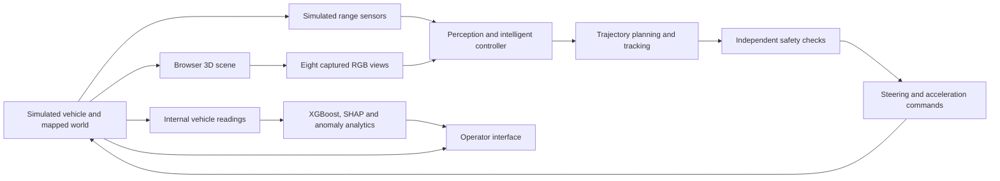

# DDS — Driving Decision System

DDS is a real-road driving simulator with a browser-based 3D cockpit. Recorded OpenStreetMap geometry and OSRM routing are combined with a simulated vehicle, traffic, range sensors and eight rendered RGB cameras.

Driving decisions belong to the planning, control and safety systems. XGBoost, SHAP and anomaly detection analyze internal vehicle readings; their labels and confidence do not command steering, acceleration or braking.

## Current capabilities

- One driving environment, with regression scenarios under Advanced testing.
- Route planning, adjustable cruise speed, physical steering and wheel animation, indicators and camera previews.
- Kinematic bicycle dynamics, steering-rate and friction limits, jerk-limited ordinary control, car following and independent safety overrides.
- Joint longitudinal/lateral planning and modeled vehicle-footprint checks for turns and lane changes.
- Eight scene-rendered RGB views with timestamped ingestion, stale-frame rejection and recovery holds. Classical pixel detection supports a bounded set of rendered traffic-control shapes.
- Background traffic following physical ego/NPC bodies and bumper clearances; geometric range sensing and tracked simulated actors.
- A server-owned simulation session and clock, WebSocket telemetry, reconnection and SQLite persistence.

## Driving and analytics ownership



Map geometry and control-location priors are not live obstacle sensing. Ego traffic-light phases come from captured pixels in scene-camera mode. Background actors use simulator world state separately from the ego controller.

## Validation snapshot — 14 October 2026

- Backend regression: **1,223 passed, 3 skipped**. Skips cover CARLA collection and two Starlette TestClient WebSocket teardown cases.
- Native frontend production build passed.
- An uninterrupted default mission ran from station zero through the sharp bend and both signals to mapped parking: **5,490 telemetry samples, zero recorded ego overlaps or road-boundary failures**, parked at exactly zero speed.
- Browser reload preserved simulation identity, epoch, parked pose and zero speed across 151 recorded samples.

This is one recorded route, seed and configuration with medium eight-NPC traffic and a 50 km/h cruise preference. It is not a success-rate estimate, physical-car validation or general Level 5 autonomy. The live drive still contained 183 camera-recovery and 29 stale-camera active samples. Telemetry sampled at 10 Hz is not exhaustive continuous collision certification.

See the [acceptance report](docs/DDS_CRITICAL_FIX_ACCEPTANCE_2026-10-14.md) for source commits, failed runs, scope and evidence locations. Raw runtime logs and screenshots referenced there are local artifacts and are not all included in this repository.

## Run locally

Use **Python 3.13**, **Node.js 20.9 or newer**, and npm. The frontend pins **Next.js 16.4.0** and **React 19.2.4**. Backend dependencies are pinned in `requirements.txt`.

From the repository root:

```sh
python -m venv venv
```

Activate with `venv\Scripts\Activate.ps1` in PowerShell, or `source venv/bin/activate` on Linux/macOS. Then:

```sh
python -m pip install -r requirements.txt
python -m uvicorn app.main:app --host 127.0.0.1 --port 8000
```

Checked-in trained artifacts support internal-reading analytics. Model training is a separate workflow, not a startup step. Health endpoint: <http://127.0.0.1:8000/api/health>.

Create `frontend/.env.local` with:

```dotenv
NEXT_PUBLIC_API_URL=http://127.0.0.1:8000
NEXT_PUBLIC_WS_URL=ws://127.0.0.1:8000/ws/telemetry
```

In a second terminal:

```sh
cd frontend
npm ci
npx next dev --hostname 127.0.0.1 --port 3000
```

Open <http://127.0.0.1:3000>. The default environment starts paused; select **Resume drive**. Map, routing and geocoding providers require network access. Recorded fallback coverage is partial and labeled. For a local production build, run `npm run build`, then `npm run start -- --hostname 127.0.0.1 --port 3000`.

## Checks

With the Python environment active, from the repository root:

```sh
python -m pip install -r requirements-dev.txt
python -m pytest tests/ -q
```

From `frontend`:

```sh
npx tsc --noEmit
npm run build
```

While the backend and browser are running:

```sh
python scripts/capture_live_diagnostics.py --url ws://127.0.0.1:8000/ws/telemetry --seconds 900 --until-parked --output output/manual-drive.json
```

The recorder rejects observed ego overlaps and road-containment failures. A timeout, missing observation or skipped integration is not a passing journey. Backend tests complement actual browser/RGB/transport checks.

## Repository guide

| Path | Purpose |
|---|---|
| `app/services/simulation_session.py` | Simulation lifecycle, scheduling and command ownership |
| `app/services/driver/` and `app/services/planner/` | Driving decisions, planning and tracking |
| `app/services/physics_engine.py` and `app/services/traffic.py` | Vehicle and background-world dynamics |
| `app/services/control_camera.py` and `app/services/scene_camera_ingress.py` | Pixel detection and timestamped RGB ingestion |
| `frontend/src/components/3d/` | Scene, vehicle and camera rendering |
| `frontend/src/store/` and `frontend/src/workers/` | Browser state and telemetry/camera transport |
| `app/data/` | Attributed recorded map and mission data |
| `scripts/` and `tests/` | Evaluation tools and regressions |

## Known limits and next work

Camera GPU/transport timing tails still cause holds. General camera/range object-track fusion remains unfinished. Road corridors, stop lines, parking poses and missing building details contain modeled assumptions. Bridges and railways lack complete elevation fidelity. NPCs lack general intersection negotiation. Arbitrary destinations do not inherit the default mission's complete infrastructure validation.

The running vehicle, sensors, weather and traffic are simulated. The offline OBD-II dataset and analytics artifacts do not establish a live physical OBD-II connection. This repository does not establish physical autonomy or production readiness.

## Data and licensing

OpenStreetMap-derived records retain attribution and provenance; see [map-data notes](app/data/README.md). There is currently no repository-wide software license file. Public availability does not substitute for a license grant.
