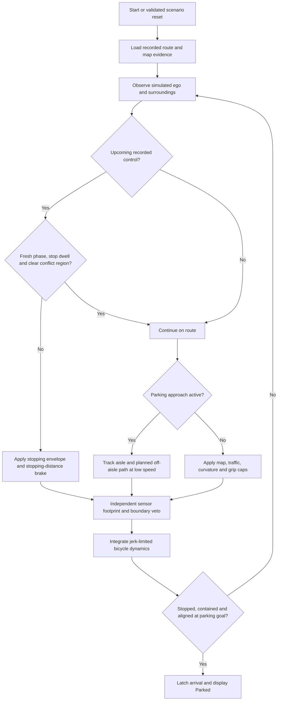

# DDS engineering and system validation report

Status: local engineering acceptance completed. Final full suite: 486 passed,
3 skipped, 38 warnings in 278.09 seconds. This is simulator validation, not
physical-car or safety certification.
Scope: real-road software simulator with explicitly simulated vehicles, traffic,
signal phases and sensors. Local worktree; no push, deployment or PR.

## Requirements and implementation

| Requirement | Implementation | Evidence status |
|---|---|---|
| Real roads, clear provenance | Recorded OSRM routes and OSM road/control/parking geometry | Installed; dated map coverage is partial |
| Intelligent driving without ML authority | Deterministic behavior/planner/controller and veto-only shield | Control boundary tests and final full regression passed |
| Junction handling | Route-associated control nodes, stop dwell, yield clearance, red/yellow/unknown phase stop, simulated phase sensor | Focused tests and live red-signal stop observed |
| Pull aside to park | Recorded exit and street approach; parking aisle; planner-selected pose inside recorded area | Complete-mission regression and final live trip reached contained pose |
| Smooth truthful HMI | Signal, parking and arrival states; actual sensor/map provenance | Build/lint passed; final parked browser rendering visually inspected |
| Full SDLC/system validation | Requirements, implementation review, unit/integration regression, build/lint, live browser/WebSocket acceptance | Final full suite passed; live system acceptance and report audit completed |

The earlier numbered engineering fixes remain part of the acceptance scope:

| Earlier item | Current evidence and practical boundary |
|---|---|
| 1: overlap/body safety | `test_safety_shield.py`, `test_safety_geometry.py`, driver sensor-footprint veto; constant-velocity short sweep, not unseen-obstacle proof |
| 2: atomic scenario/reset | `test_simulation_session.py`, `test_engineering_runtime.py`, malformed-command live rejection with unchanged epoch/pose |
| 3: arrival/HMI | explicit arrival telemetry; completed parking trip and actual Parked browser state |
| 4: map recovery/pins | RoutePreview retry/follow/recenter and permanent Start/Destination labels; prior blocked/recovered browser evidence in DDS_FIXES_1_6_2026-10-11.md |
| 5: runtime headroom | inference thread budget and map-index prewarm; full-suite timing gates; live timing above retains misses and scheduling lateness |
| 6: road semantics | dated posted limits, direction/lane-count matching, recorded controls, supported junction behavior and connected parking mission; missing widths and broad map coverage remain explicit |

Higher speed preferences remain 10–120 km/h in the command contract. The
highway map cap is 65 mph / 104.60736 km/h. Earlier live mapped-speed evidence
in `output/mapped-speed-live.json` reached 104.607358 km/h with a 120 km/h
preference; it did not imply permission to exceed a mapped limit. The parking
trip intentionally used a 50 km/h preference and lower approach/maneuver caps.

## Architecture and location of AI

```mermaid
flowchart LR
  OSM[Recorded OSM roads, controls, parking areas] --> MAP[Map matcher and route-control association]
  OSRM[Recorded OSRM road route] --> ROUTE[Route smoothing and Frenet geometry]
  WORLD[Deterministic simulated world] --> SENS[Simulated forward range and surround sensors]
  WORLD --> EGO[Ego speed, pose, acceleration and powertrain readings]
  SENS --> PER[Perception, tracking and occupancy]
  PER --> PRED[Deterministic actor prediction and conflict checks]
  MAP --> BEH[Deterministic driving behavior]
  ROUTE --> BEH
  EGO --> BEH
  PRED --> BEH
  BEH --> PLAN[Lane and parking trajectory planner]
  PLAN --> CTRL[Steering and longitudinal controller]
  SENS --> SHIELD[Independent veto-only safety monitor]
  CTRL --> SHIELD
  SHIELD --> ACT[Steer and acceleration commands]
  ACT --> WORLD
  EGO --> QUEUE[Bounded analytics queue]
  QUEUE --> ML[AI: scaled internal readings classifier]
  ML --> SHAP[SHAP explanation and anomaly analytics]
  SHAP --> TEL[Telemetry assembly]
  WORLD --> TEL
  SHIELD --> TEL
  TEL --> WS[WebSocket]
  WS --> WORKER[Browser telemetry worker]
  WORKER --> STORE[Zustand state]
  STORE --> UI[Next.js cockpit, real map and Three.js view]
  UI --> COMMAND[Validated user commands]
  COMMAND --> WORLD
  TEL --> DB[Asynchronous local persistence]
```



The AI classifier resides in `app/services/inference.py`. It loads
`best_model.pkl`, `scaler.pkl`, `label_encoder.pkl` and `optimal_features.json`.
Explainability lives in `app/services/explainability.py`. Analytics runs through
a bounded background queue and worker, outside driving control. Its labels may
use action-like names, but they do not command the vehicle. No model retraining
or claimed accuracy improvement was performed in this engineering pass.

The intelligent driving system resides in `app/services/driver/driver.py`,
`junctions.py`, `parking.py`, planner modules and the safety monitor. It uses
geometry, constraints, sensor observations and state machines. It does not
read NPC identities through its sensor observation boundary.

## Data travel and scheduling

Sensors are virtual geometric measurements, not physical camera images or
LiDAR point clouds. The forward range observation feeds IDM following control.
The surround rig has five modeled frustums: forward long range (150 m / 30°),
forward wide (60 m / 120°), left and right blind spots (80 m / 90° each),
and rear centre (100 m / 60°). Coverage has gaps; a clear sensor result is not
proof that every real obstacle is visible. Post-noise detections feed the
tracker and a separate source-free footprint safety feed. Simulated signal
observations include their simulation-time timestamp and provenance.

Powertrain readings include speed, RPM, coolant temperature, fuel rate,
COâ‚‚ and altitude. They are simulated readings consumed by the internal
analytics feature pipeline. The report does not portray those values as
measurements from a physical vehicle.

The session owns a deterministic 100 Hz scheduling clock. Surround perception
runs at 20 Hz; prediction and planning at 10 Hz; controller, safety and physics
at 50 Hz. Commands are validated and applied at session boundaries. A reset
replaces runtime handoffs and increments the epoch so obsolete analytics and
telemetry cannot become current state. Browser rendering and slow analytics
are not allowed to own simulation time or driving authority.



## Validation artifacts

| SDLC phase | Work performed | Acceptance evidence |
|---|---|---|
| Requirements | Real roads, simulator labeling, no ML driving authority, local-only changes, parking and junction behavior | Requirement table above and implementation boundaries |
| Design | Sensor-only driver interface, deterministic scheduling, dated map semantics, low-speed parking path, safety veto | Architecture and data-flow diagrams; interfaces/modules |
| Implementation | Control import, junction state machine/braking, parking mission, HMI states, map surface and integrity-cache correction | Current local source and focused regressions |
| Unit/integration | Geometry, stop/clearance dwell, stale/unknown phases, reset/authority, map provenance, ML separation | Pytest artifacts below |
| System/acceptance | Running FastAPI + Next.js, actual browser, WebSocket full parking trip, nine scenario command smoke checks | Live traces and browser snapshots |
| Build/static checks | Production Next build, full lint, UI contracts, dependency compatibility, whitespace checks | Build/lint/contract logs |
| Release review | Local-only review; no release or deployment requested | No push, PR, deploy or new commit performed |
| Maintenance | Record defects and limitations; preserve failed run and final evidence separately | This report and source-linked evidence logs |

- `output/parking-final-focused.txt`: 32 passed, 8 warnings in 9.01 seconds.
- `output/parking-frontend-build.txt`: production compilation, TypeScript and
  static-page generation passed.
- `output/SDLC-full-backend-before-fixes.txt`: first full run, 481 passed,
  4 failed, 3 skipped in 261.29 seconds. Failures exposed cached source
  validation and assertions tied to the old mission or random traffic.
- `output/SDLC-failure-regressions.txt`: corrections checked, 26 passed,
  1 skipped in 18.19 seconds. Collision authority was not weakened.
- `output/SDLC-full-backend.txt`: final full regression after all corrections: **486 passed, 3 skipped,
  38 warnings in 278.09 seconds**. Existing timing gates were retained.
- `output/SDLC-full-backend-before-speed-lookahead.txt`: 485 passed, 3 skipped,
  38 warnings in 247.04 seconds. This green run predates the final parking-speed
  lookahead correction and must not be used as proof for that correction.
- `output/parking-speed-regression.txt`: 4 passed in 16.22 seconds, including
  a complete simulated mission asserting approach speed ≤10.1 km/h, maneuver
  speed ≤5.1 km/h, containment, no modeled red-line crossing, and reaching the
  parking pose. The final live trip and full suite after this change completed successfully.
- `output/SDLC-frontend-lint.txt`: 0 errors, 5 existing unused-symbol warnings.
- `output/parking-development-trace.json`: deterministic development mission.
- `output/SDLC-live-trip-summary.json`: final trip 170.9 simulation seconds;
  sampled acceleration delta per second at most 2.5 m/s³. The final timing
  snapshot recorded 2 control-stage deadline misses, maximum control execution
  21.43 ms, and maximum scheduling lateness 100.00 ms. Perception/planning had
  zero deadline misses in this trip. Real-time factor 1.0 is not a hard-real-time
  guarantee. Sampling at telemetry rate cannot prove every internal jerk peak.
- `output/SDLC-ui-contract.txt`: 7 panels channel-bound, 26 live files clean.
- `output/SDLC-lint-dependencies.txt`: Next root-directory globs/rules verified.
- `output/SDLC-live-rest.json`: actual running-server health, scenarios,
  session history and analytics-summary endpoints returned HTTP 200. Model
  loaded and ready-for-streaming fields were true, with no health errors.
- `output/SDLC-live-persistence.json`: read-only SQLite observation showed
  telemetry rows increase from 770,179 to 770,259 and score rows from 219,891
  to 219,961 between samples; `foreign_key_check` returned zero violations in
  both. These counts include earlier local sessions and are not a throughput
  benchmark. The asynchronous persistence path is observed working.
- `output/SDLC-live-scenarios.txt` and `output/fixes-live-scenarios.json`:
  all nine installed scenarios applied, each yielding 21 finite-pose frames
  during its two-second smoke window. Malformed friction input was rejected;
  epoch and physical state stayed unchanged. This is command/reset and runtime
  smoke coverage, not nine complete autonomous trips.
- `output/parking-live-system.json`: 1,710 actual WebSocket state frames;
  maximum speed 49.999997 km/h for the 50 km/h preference. Final state reports
  ARRIVED, target speed zero and a contained, aligned parking pose. Minimum
  reported distance before the modeled stop line while a red control remained
  active was 0.7596 m. This measures this trip, not a general success rate.

The first junction development trace overshot a red modeled stop line. This
was reported immediately and corrected with stopping-distance braking. The
corrected trace held before the line rather than treating a green phase seen
far away as permanent permission. The live browser subsequently displayed
Signal red at standstill before the line.

The final browser snapshot displayed 0 km/h, Parked, and Mapped parking area /
simulated vacancy. Full lint found a CommonJS import-rule mismatch in the
existing vendor shim; the rule exception is scoped to that `.cjs` entry point.
After the latest backend restart, browser reconnection succeeded and the route
label correctly included Broadway, Old Bayshore Highway and the parking area.
The final-code parking trip is being repeated because rendering/route metadata
changed after the first live capture; this is new-change validation, not an
assumed repetition of the earlier result.
That trip has now completed with the same contained parking outcome and
includes the actual parking polygon in telemetry. Browser observations during
the maneuver showed Parking, 5 km/h and the recorded area surface, with the
correct street approach label. `output/SDLC-parked-browser.txt` preserves the
subsequent parked UI snapshot. Full-scenario smoke testing follows the trip;
its brief observation windows are not whole-scenario safety certification.
The first live run predated the final parking-area rendering and route-label
updates. The subsequent restarted-backend browser check validated both. The screenshot named
`signal-red-live.png` was captured after the vehicle had resumed and actually
shows Parking approach; the stop observation is supported by the earlier
browser snapshot and live telemetry, not that screenshot filename.

## Limits that remain explicit

Final acceptance audit found that phase-based parking speed targets alone
were insufficient: actual speed entered the approach at up to 45.42 km/h
and the maneuver at up to 9.94 km/h in the earlier live trace. This defect was
reported and corrected with braking-distance lookahead before both phase
boundaries. The new development trace measured at most 10.00 km/h during
active approach and 5.001 km/h during the maneuver. The live-trip statistics above now refer to the final corrected capture; the
pre-fix trace is preserved separately as parking-live-system-before-speed-lookahead.json.

The suite has known WebSocket TestClient skips for the installed Starlette 1.x
portal teardown issue. The running-server WebSocket evidence above exercises
real sockets rather than substituting a skipped harness test for validation.
CARLA physical/world integration is not part of this deterministic simulator
acceptance. The report must retain the terminal skip count and reasons.

OSM control-node coordinates are not surveyed stop-line geometry; the offset
is a modeled policy. Signal phases are deterministic simulated infrastructure,
not a live traffic-light feed. Parking poses are planner-selected unmarked
poses, not mapped individual bays. Vacancy comes from simulated sensors.
Access restrictions are checked against recorded tags; live access permission
is not verified. Lane widths and broad occlusion safety are not established.
This report makes no physical-car, all-roads autonomy or safety certification
claim. The final acceptance evidence validates the installed supported simulator
mission; these limitations remain outside its demonstrated operating envelope.

## Final live acceptance after speed lookahead

The latest live capture reached ARRIVED and parked_in_mapped_area. Maximum
observed active-approach speed was 10.0659 km/h; maximum maneuver speed was
5.0008 km/h. These are measured actual speeds, including small controller
tracking error, rather than exact target-speed guarantees. Every sampled
maneuver footprint was contained in the recorded polygon. The final browser
screenshot `output/playwright/cockpit-redesign/SDLC-final-parked.png` was
visually inspected: 0 km/h, Parked, both map pins, recorded parking surface,
correct approach label, and explicit simulator provenance. No browser console
errors were recorded; one existing warning remained.

`output/SDLC-source-manifest.json` hashes 151 application, test, frontend source
and configuration files at local HEAD a4c9072 on phase-7.5-ui-design. The
worktree includes pre-existing changes and remains uncommitted. The previously
reported cloud commit 7b124e6 was not present locally and was not blindly applied.

## Reproduction commands

Run from `D:\college\Major Project\DDS_Rebuilt` in PowerShell:

```powershell
.\venv\Scripts\python.exe -m pytest -q
npm --prefix frontend run build
npm --prefix frontend run lint
npm --prefix frontend run verify:ui
npm --prefix frontend run verify:lint-deps
```

With backend/frontend already running, the live checks used:

```powershell
.\venv\Scripts\python.exe output/capture-parking-live.py
.\venv\Scripts\python.exe output/validate-sequence-live.py
.\venv\Scripts\python.exe output/check-system-rest.py
.\venv\Scripts\python.exe output/check-system-persistence.py
```

The parking capture and scenario checks intentionally change the running
simulation's scenario. The read-only REST/persistence checks do not. They use
the installed real ML artifacts; pytest REST/DB fixtures use isolated SQLite
and some deliberately stub analytics to isolate protocol behavior. Tests using
stubs are not presented as ML evaluation. No classifier accuracy or autonomous
success percentage was inferred from these engineering checks.

## Completion audit

The final source manifest was rechecked with zero changed source files after
validation started. The terminal full suite passed all 486 executed checks;
three known harness skips remain explicit. Production build, lint (zero errors,
five existing warnings), UI/dependency contracts, actual running-server REST,
persistence, WebSocket trip and browser rendering evidence were inspected.
The earlier four full-suite failures and later parking-speed defect were
reported, fixed and revalidated without relaxing timing/safety thresholds.

The backend remains on port 8000 and frontend on port 3000. The final drive is
parked for manual inspection. All changes remain local and uncommitted; no PR,
push, release, deployment or external message was performed. This report
supersedes the unfinished parking/control notes in the earlier dated follow-ups.


## Steering follow-up — 12 October 2026

The active session now uses center-referenced bicycle integration, bounded-preview tracking, Ackermann front-wheel geometry and distance-integrated tire rolling. Rendering and camera reset with the scenario epoch; pose telemetry exposes integrated position rather than route-endpoint reconstruction. Final validation: 494 backend tests passed with 3 known harness skips; production frontend build passed, lint has zero errors and five existing warnings. Two live mapped missions and browser left/right wheel, pause and reset observations were executed. Worst measured road-approach tracking error improved from 2.90 m to 1.19 m; sharp junction precision remains incomplete. See [the steering evidence report](DDS_PRECISE_TURNING_2026-10-12.md) for exact scope, artifacts and limitations. Earlier test counts above describe earlier source versions.


## Supervised controller advancement — 12 October 2026

Local checkpoint `ea6b4bbc18d17d100050cc407959caa9a5e092d9` preserves the previous working version. Accepted feature `5294885ad094a18d5e5d3b23d15942804d158d82` adds center-consistent and offset-path turn tracking, corrected curvature/grip speed targets, invalid-reference braking and an explicit stop status. It was implemented/tested in a separate worktree and independently reviewed before main integration. Sandbox regression: 535 passed, 3 known skips; frontend build passed, lint zero errors/five existing warnings. The actual integrated WebSocket mission parked with containment, and worst measured approach tracking error was 0.83 m. Main targeted regression and browser steering/pause observations passed. See [the supervised development and provenance record](DDS_SUPERVISED_DEVELOPMENT_2026-10-12.md) for exact evidence and remaining limitations. These are simulator/controller claims; general Level 5 autonomy is not established.


## 12 October 2026 — joint maneuver and anticipatory turn batch

Accepted local feature `c2c68725be38ea95359d6484896a4241b803f8fd`. Full combined suite:668 passed,3 skipped; frontend build passed; actual browser/live steering, parking, reset and reconnect checks recorded. See [measured acceptance and remaining limits](DDS_JOINT_TURN_ACCEPTANCE_2026-10-12.md). The user-authorized continuation finishes this batch; no next feature was started.


## 13 October 2026 — sensor, turning, corridor and driving validation batch

Accepted local feature/UI `4e757c34b2116bec0eb150e18d58447aaef57e49`; frozen backend/evaluator `fdd72d3928c90d169968d0e16c30d70395832edd`:836 tests passed,3 skipped. Final frontend production build and live sensor, dry/wet steering, exact-stop parking, traffic recovery, recorded stop/yield, reset and reconnect checks passed within the documented simulator scope. See [the new acceptance and provenance record](DDS_ITEMS_1_4_ACCEPTANCE_2026-10-13.md). This supersedes the earlier pending items for these scoped implementations; broader Cartesian/physical/friction and timing certification remain unproved. All commits remain local.


## 13 October 2026 — runtime smoothness and map/parking evidence

Local code `6e40b78ee37c04e7be0f2ffe160a190640f645be`:872 backend tests passed,3 skipped; final main frontend build passed. Narrow Proactor cleanup and queue accounting fixes, bounded timing capture, stable action subscriptions, recorded map provenance and conservative parking access/direction checks were sandboxed and reviewed before integration. Foreground browser measurements and live TCP/map/reconnect evidence are in [items5–6 acceptance](DDS_ITEMS_5_6_ACCEPTANCE_2026-10-13.md). Detailed overlays and scheduling outliers remain measured limitations; no universal60FPS, surveyed bays, physical access or Level5 claim. No push/PR/deployment. Original59-commit review stays separate from this new batch.
